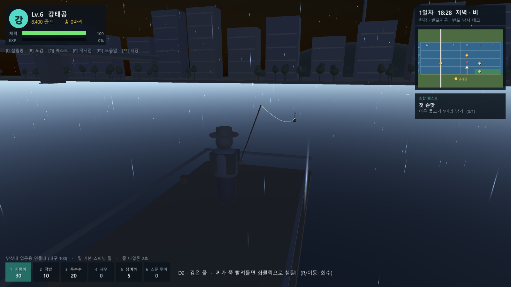
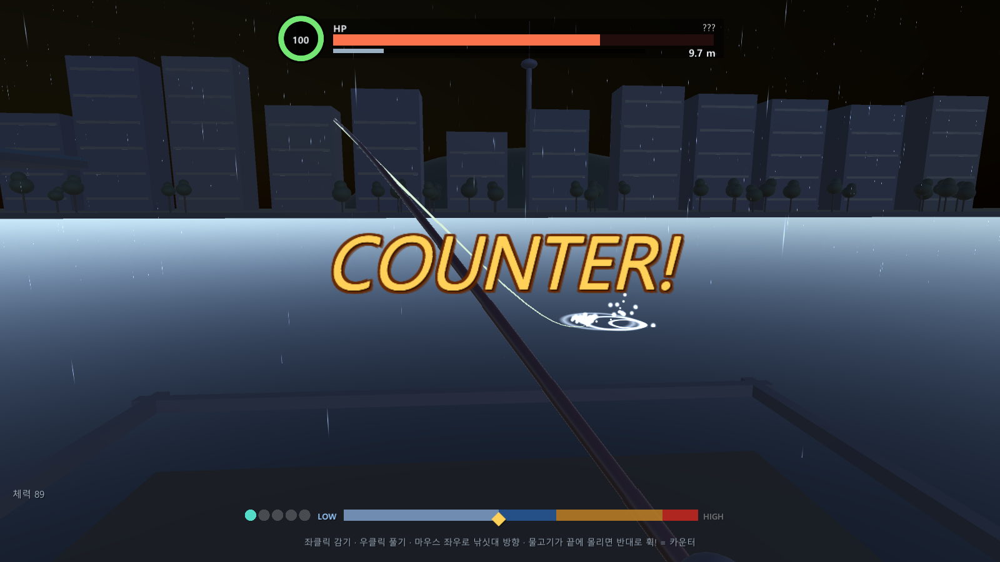
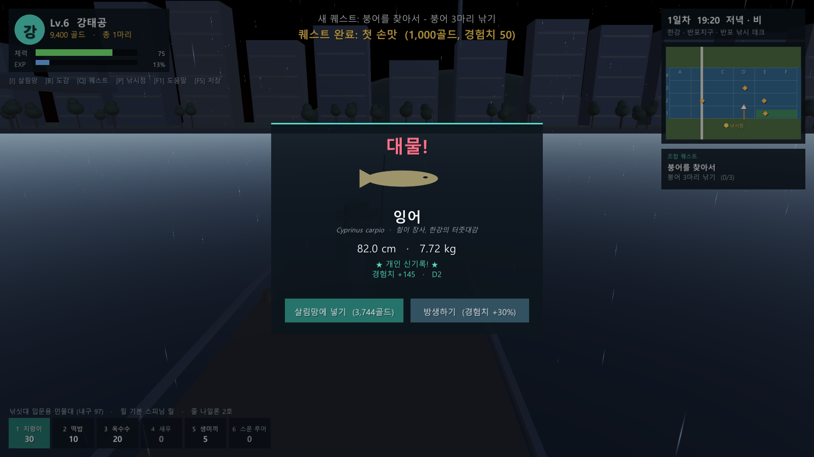
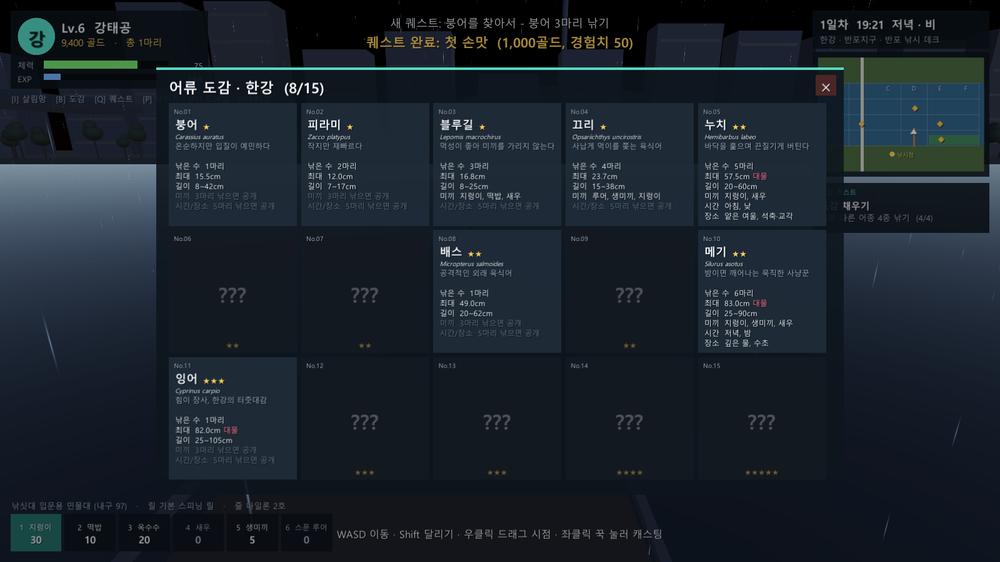

# Project Fishing — 청풍명월 솔로

피망 온라인 낚시 게임 **「청풍명월」**(2012~2021, 서비스 종료)의 손맛을 **혼자서** 즐기기 위해 Unity로 다시 만드는 프로젝트입니다.
원작 소스나 리소스는 쓰지 않았고, 공개된 기사와 플레이 후기에서 게임 메커니즘만 참고했습니다.

현재 버전은 **한강(반포지구) 맵 하나**입니다. 국내 다른 맵은 로드맵에 있고, 해외 맵은 아직 범위 밖입니다.

| 필드 | 파이팅 |
|---|---|
|  |  |
| **결과** | **도감** |
|  |  |

## 특징

- **원작식 1인칭 파이팅**
  - 좌클릭 감기, 우클릭 풀기, 마우스로 낚싯대 방향을 잡는다.
  - 게이지는 3종이다: 거리, 물고기 HP, 장력(LOW~HIGH). 여기에 파이팅 레벨 링이 붙는다.
  - 물고기가 화면 끝까지 달리면 반대로 휙! **카운터**와 콤보를 노릴 수 있다.
  - HP 20% 이하로 깎고 5m 안으로 끌어오면 **랜딩**.
- **찌낚시**: 캐스팅 게이지, 예신(헛챔질 주의)과 본신, 챔질 타이밍, 대물이면 **♥두근두근♥**
- **한강 생태**
  - 어종 16종(붕어, 잉어, 쏘가리, 메기, 가물치, 뱀장어, 전설의 황금 비단잉어…)과 잡동사니가 있다.
  - 서식지, 미끼, 시간대, 날씨에 따라 입질이 달라진다.
  - 미니맵에 보이는 **어군**이 시간에 따라 이동한다.
- **성장**
  - 레벨 1~25, 장비 10종(경조/연조 낚싯대, 릴, 줄), 미끼 6종, 낚싯대 내구도
  - 캐릭터 체력 관리: 하이텐션을 쓰면 빨리 지친다. 요리나 김밥으로 회복한다.
- **수집**: 단계별로 열리는 도감, 살림망, 낚시점 판매, 한국 낚시 조합 이야기 퀘스트 8개
- **분위기**: 낮과 밤, 노을, 비, 새벽 물안개, 가로등, 절차적 효과음(릴 클릭, 물보라, 줄 끊김)

## 실행

1. **Unity 6000.3.17f1**로 이 폴더를 연다.
2. `Assets/Scenes/HanRiver.unity`를 열고 Play한다.

명령줄로 빌드할 수도 있다 (Git Bash).
```bash
sh tools/build.sh
```
빌드 결과는 `Builds/Windows/ProjectFishing.exe`.

## 조작

| 입력 | 동작 |
|---|---|
| WASD / Shift | 이동 / 달리기 |
| 우클릭 드래그 · 휠 | 시점 · 줌 |
| 좌클릭 누르기 → 떼기 | 캐스팅 |
| 좌클릭 (찌가 쭉 빨려들 때) | 챔질 |
| R | 찌 회수 |
| 1~6 | 미끼 선택 |
| **파이팅**: 좌클릭 / 우클릭 / 마우스 좌우 / Space | 감기 / 풀기 / 낚싯대 방향·카운터 / 랜딩 |
| I / B / Q / P / F1 / F5 / Esc | 살림망 / 도감 / 퀘스트 / 낚시점(근처) / 도움말 / 저장 / 닫기 |

## 문서

| 문서 | 내용 |
|---|---|
| [01-original-research.md](docs/01-original-research.md) | 원작 조사: 서비스 이력, 원작 시스템, 반영 현황, 출처 |
| [02-game-design.md](docs/02-game-design.md) | 게임 디자인: 루프, 입질 가중치, 파이팅 공식, 카운터, 체력, 성장, 맵 격자, 어종표, 퀘스트 |
| [03-architecture.md](docs/03-architecture.md) | 코드 구조, 실행 흐름, 상태 머신, 확장 방법(어종/장비/맵/아트) |
| [04-balance.md](docs/04-balance.md) | 밸런스 시뮬레이션 방법, 결과 요약, 조정 이력, 손볼 상수 |
| [balance-report.md](docs/balance-report.md) | 시뮬레이터가 생성한 전체 결과표 |
| [05-dev-guide.md](docs/05-dev-guide.md) | 개발 환경, 에디터 메뉴, 명령줄 도구, 자동 스크린샷, 세이브, 디버깅 |
| [06-roadmap.md](docs/06-roadmap.md) | 다음 작업: 서천 앞바다·제주, 배, 수족관, NPC 대회 |

## 구조 한눈에

```
Assets/Scripts
  Core/      진입점(GameBootstrap), 시계·날씨·조명, 저장, 퀘스트
  Data/      어종·장비·퀘스트 정적 테이블
  World/     한강 맵 정의, 프리미티브 월드 생성, 어군, 효과
  Player/    3인칭 캐릭터, 카메라(3인칭 ↔ 1인칭)
  Fishing/   낚시 상태 머신, 파이팅 시뮬레이션(FishFight), 입질 선택, 찌
  UI/        코드로 만든 UGUI: HUD, 파이팅 HUD, 결과·살림망·도감·낚시점·퀘스트
  Audio/     절차적 효과음
  Dev/       자동 연출·스크린샷
Assets/Editor  셋업·빌드 도구, 밸런스 시뮬레이터
```

씬에는 `GameBootstrap` 하나만 있고, 나머지는 모두 코드로 만듭니다. 아트 에셋 없이 프리미티브와 절차적 텍스처, 사운드만 씁니다.

## 크레딧

- 원작: 「청풍명월」 개발 저스트나인, 서비스 네오위즈게임즈(피망). 이 프로젝트는 원작과 관련이 없는 개인 팬 프로젝트입니다.
