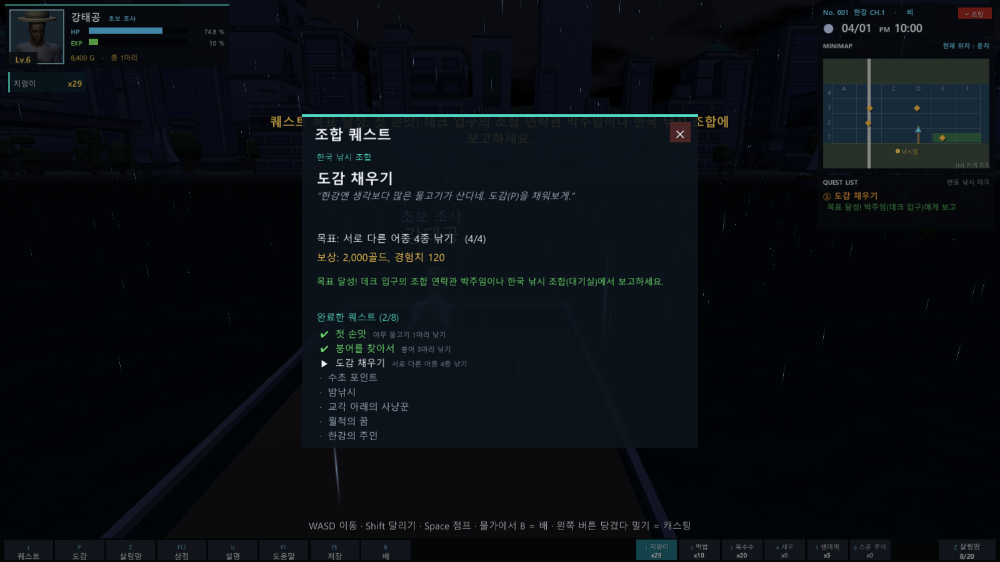

# 짭풍명월 — Project Fishing

제작: **제쓰로네 게임공방** (Jethro's Game Company)

피망 온라인 낚시 게임 **「청풍명월」**(2012~2021, 서비스 종료)의 손맛을 **혼자서** 즐기기 위해 Unity로 다시 만드는 프로젝트입니다.
원작 소스나 리소스는 쓰지 않았고, 공개된 기사·플레이 후기·플레이 영상에서 게임 메커니즘만 참고했습니다.

원작 낚시터 목록의 국내 낚시터 11곳(한강 · 홍현 앞바다 · 서천 앞바다 · 영흥도 · 태안반도 · 삼척 앞바다 · 동해 등대섬 · 헌화로 · 욕지도 · 청진포구 · 거문도)과 원작 이벤트 지역 **제주**에서 원작 한국 코스(Lv.1~25)를, 원작 해외 거점 전체 — **동남아 12곳**(하롱베이 · 앙코르와트 · 빈펄 · 돈콘 · 푸켓 · 방콕 · 코사무이 · 랑카위 · 센토사 · 텔록 바텍 · 플라우 티오만 · 플라우 탱글), **지중해 4곳**(산토리니 · 크레타 · 자킨토스 · 듀덴 폭포) + 솔로판의 **나일강 하류**에서 그 뒤(Lv.25~40)를 즐길 수 있습니다. 모두 **29곳**, 어종 **165종**.
조작과 화면 구성은 원작 플레이 영상을 프레임 단위로 분석해서 맞췄습니다.

| 인트로: 제쓰로네 게임공방 | 타이틀: 짭풍명월 |
|---|---|
|  |  |
| **대기실 (한국 낚시 조합)** | **낚시터 목록** |
|  |  |
| **캐릭터 (진짜 옷 메쉬, 반장갑)** | **의상 (능력치 레이더)** |
|  |  |
| **홍현 앞바다 (남해)** | **서천 앞바다 (서해, 물때·갯벌)** |
|  |  |
| **겨울 한강 얼음낚시** | **낚시 크루저 (먼바다)** |
|  |  |
| **삼척 밤바다 (오징어배 집어등)** | **욕지도 가두리 낚시터** |
|  |  |
| **동해 등대섬** | **청진포구 명태 덕장** |
|  |  |
| **제주 서귀포 (돌하르방·한라산)** | **제주 주상절리·외돌개** |
|  |  |
| **낚시터 목록 (한국·동남아·지중해·아프리카 거점 탭)** | **하롱베이 (석회암 봉우리·수상 마을)** |
|  |  |
| **산토리니 (칼데라·방파제 테트라포드)** | **나일강 하류 (피라미드 노을)** |
|  |  |
| **앙코르와트 (해자 건너 연꽃 봉오리 탑·사자상)** | **방콕 (강 건너 새벽 사원 왓 아룬)** |
|  |  |
| **빈펄 (바다 위 초가 정자·케이블카)** | **푸켓 (팡아만 석회암 섬·하얀 대불)** |
|  |  |
| **랑카위 (독수리 광장)** | **센토사 (마리나 야경·열기구)** |
|  |  |
| **크레타 하니아 (베네치아 항구·하얀 산)** | **듀덴 폭포 (바다로 떨어지는 폭포)** |
|  |  |
| **코사무이 (바다 위 섬의 황금 대불)** | **자킨토스 (나바지오 난파선 해변)** |
|  |  |
| **플라우 티오만 (곡선 리조트 호텔·보라 파라솔)** | **플라우 탱글 (바다 위 데크 별장)** |
|  |  |
| **버스킹 무대의 낚시 아이돌 유니티짱 (다가가면 손 흔들어 인사)** | **밤의 한강 다리 밑 귀신** |
|  |  |
| **한강 공원 벤치의 수다 (Mixamo 사람들)** | **밤 데크의 네온 댄서·좀비들** |
|  |  |
| **한강 둔치 공원 (실사 활엽수·소나무·풀)** | **삼척 바닷가 (실사 바위·풀)** |
|  |  |
| **거문도 등대** | **홍현 갯바위 섬 (반복 없는 지형 텍스처·실사 바위)** |
|  |  |

| 캐스팅 (당겼다 밀기) | 챔질 (찌 게이지) |
|---|---|
|  |  |
| **1인칭 파이팅 (휘는 낚싯대·릴, 카운터 방향 표시)** | **카운터 찬스** |
|  |  |
| **RESULT (3D 물고기, 파이팅 기록 차트)** | **도감 (어종별 3D 모델)** |
|  |  |
| **조합 낚시 대회** | **수족관** |
|  |  |
| **나일농어 158cm 파이팅** | **조합 퀘스트 (이야기 45개, 스크롤)** |
|  |  |
| **NPC 퀘스트 완료 카드** | **납품 (게이지가 차면 다음 납품 두 배)** |
|  |  |
| **통발 설치·수거** | **내 캐릭터 (장비 6칸 · 최종 능력치)** |
|  |  |
| **낚시터 로딩 화면** | **ESC 메뉴** |
|  |  |
| **한강에서 본 남산서울타워·롯데월드타워** | **밤 스카이라인 (창 불빛·별)** |
|  |  |
| **63빌딩과 동작대교** | **한강공원 CU 편의점** |
|  |  |
| **하롱베이 석회암 봉우리 (실사 석회암·빗물 얼룩·덤불)** | **청진포구 덕장 (코를 엮어 건 명태)** |
|  |  |
| **낚싯대를 눕히면 줄이 처진다** | **세우면 팽팽하다** |
|  |  |

**물고기 165종** (Blender 스크립트로 만든 어종별 모델·텍스처, 반투명 지느러미)


## 특징

- **원작 흐름**: **한국 낚시 조합(대기실)**에서 시작 → [낚시터 선택하기] → 거점 탭(한국·동남아·지중해·아프리카)과 지도에서 낚시터 → 채널 CH.1~5 입장. 필드 오른쪽 위 `↩ 조합`으로 돌아온다. 레벨로 맵이 열린다(한강 Lv.1, 홍현 Lv.5, 서천 Lv.6, 영흥도 Lv.9 … 제주 Lv.21 … 거문도 Lv.24, 하롱베이 Lv.25 · 앙코르와트 Lv.26 · 산토리니 Lv.28 · 나일강 Lv.31 … 플라우 탱글 Lv.39).
- **원작 조작 그대로**
  - **캐스팅**: 왼쪽 버튼을 누르고 당긴 다음 빠르게 밀면서 놓는다. 큰 비거리 숫자와 궤적. 던지기 전·찌를 기다리는 동안 마우스 위아래로 낚싯대를 세우고 눕힌다(눕히면 줄이 처진다).
  - **챔질**: 왼쪽 버튼을 누른 채 좌우로 흔든다. 찌가 완전히 잠겼을 때 흔들면 **PERFECT**.
  - **파이팅(1인칭)**: 좌클릭 감기, 우클릭 풀기, 마우스로 낚싯대 방향. HP 바·거리 눈금자·파이팅 레벨 링·데미지 숫자. 물고기가 질주하면 반대로 휙 → **카운터** 콤보.
  - HP를 깎은 뒤 5m 안으로 끌어오면 **랜딩 찬스**, 연타로 0m까지 → **RESULT** (처음 낚은 어종은 FIRST GET).
  - **포커싱(Q)**: 8초 동안 장력이 천천히 변하고 데미지가 커지는 원작 파이팅 스킬 (20분에 한 번).
  - **체력**: 20% 아래면 지치고(힘·릴 감기 약해짐) 5% 아래면 탈진. 음식 5종으로 회복.
- **낚시법**: 찌낚시, **루어**(감기 속도·저킹 액션), **플라이**(털바늘·플라이대), **트롤링**(배를 몰며), 겨울 한강 **얼음 구멍 낚시**(빙어).
- **맵 29곳**
  - **한강**: 동작대교·낚시 데크·수초 만, 밤 다리 불빛이 물에 길게 비친다. 강 건너 **남산서울타워·롯데월드타워·63빌딩**과 먼 시가지(밤엔 창 불빛), 둔치의 **CU 편의점**(한강라면 조리기, 파라솔 탁자).
  - **홍현 앞바다**(남해): 방파제·빨간 등대·테트라포드·갯바위 섬·다랭이 마을, 자이언트 그루퍼 어군, 먼바다의 전설 다금바리·돗돔.
  - **서천 앞바다**(서해): **물때**(밀물·썰물에 갯벌이 드러남), 홍원항 흰/빨간 등대, 동백정, 주꾸미·갑오징어(에기)·민어. 원작 대회 장소.
  - **해안 낚시터 9곳**(해안 맵 틀 `CoastMapDef`): 영흥도(썰물에 걸어 들어가는 목섬, 영흥대교, 해무), 태안(만리포·신두리 사구·할미할아비바위), 삼척(추암 촛대바위, 밤바다 집어등), 동해 등대섬(큰 등대), 헌화로(절벽 해안도로·바다부채길·진달래, 대문어 굴), 욕지도(가두리 낚시터·출렁다리), 청진포구(눈 덮인 항구·명태 덕장, 명태 어군), 제주(외돌개·주상절리·한라산·돌하르방·귤밭, 다금바리 어군), 거문도(거문도 등대·백도, 부시리).
  - **해외 17곳**(같은 틀 + 강·지역 양식 집·나무, 새 맵은 `World/Maps/<이름>.cs` 하나에 사양·랜드마크·이야기): 하롱베이(석회암 봉우리·정크선·수상 마을), 산토리니(칼데라·흰 집·풍차), 나일강 하류(펠루카·피라미드), 앙코르와트(해자·연꽃 봉오리 탑·사자상), 빈펄(초가 정자·케이블카), 돈콘(수상 가옥·여울), 푸켓(하얀 대불·팡아만), 방콕(왓 아룬), 코사무이(황금 대불), 랑카위(독수리 상·스카이 브리지·맹그로브), 센토사(머라이언·마리나 스카이라인·열기구), 텔록 바텍(망루·롱테일 보트), 티오만(곡선 리조트 호텔·용의 뿔), 탱글(바다 위 데크 별장), 크레타(이집트 등대·모스크·하얀 산), 자킨토스(하얀 절벽·난파선), 듀덴(바다로 떨어지는 폭포·토로스 산맥). 청진포구 덕장엔 코를 엮어 건 명태가 줄지어 마른다.
- **생태**: 어종 **165종** + 잡동사니 6종. 서식지·미끼·시간대·날씨·**계절**(한 달 = 게임 7일, 제철 어종)에 따라 입질이 달라진다. 수면의 하얀 소용돌이 **어군**(큰/작은 어군), 고기떼를 모두 흩으면 나오는 **히든 어군**, 고기떼를 쫓는 **포식자 어군**, 지역 지도(M).
- **괴물 어종**: 괴물잉어·괴물가물치·폭군삼치·황새치를 낚으면 대물 코인 → 풍림화산 낚싯대·릴로 교환.
- **배 4종**: 고무보트·돛단배(바람)·고속보트·낚시 크루저. 연료, 배마다 다른 흔들림(안정성 × 파도), 먼바다 포인트(대물 +8%).
- **성장·수집**: 레벨 1~40(레벨 보상 장비), 장비(낚싯대·릴·줄·배) 강화 +15, 미끼 + 해체 미끼 5등급, 도감, 살림망, 이야기 퀘스트 87개(낚시터마다), **일일 의뢰**, **대물 도전**, **업적**·칭호, **빙고 5×5**, **출석 체크**, 낚시 일지, 소라고동 교환소, **납품소**(살림망 고기를 팔면 납품 게이지가 차고, 가득 차면 다음 납품 두 배), **통발**(낚시터에 설치해 두고 20시간 뒤 수거), **내 캐릭터 창**(장착 장비 칸 + 최종 능력치 표), **의상**(6부위 25벌, 부위별 능력치), 대기실 **수족관**.
- **조합 낚시 대회**: 매일 09~15시, AI 낚시꾼 7명과 마릿수·최장·길이 합계로 겨룬다. 계급 엠블럼, 우승 상품 거거 낚시대·나팔고둥 릴.
- **손맛**: 마디를 펼치는 뽑기대가 줄 방향으로 휘고 출렁인다. 장비별 릴이 돌고, 릴·드랙·카운터 소리, 게임패드 진동.
- **화면**: 다크 유리 UI(Translucent Image + Paraform), EasyChart 차트, 후처리(블룸·톤매핑·AO), 낮밤(하루 24분)·노을·해달별(은하수·반짝이는 별), 날씨(흐린 날 층구름·비·겨울 눈), 물결 셰이더, 새벽 물안개. 바닥·지형은 반복 무늬를 깨는 셰이더(`Fishing/Ground`·`Fishing/Terrain`), 테트라포드·등대·바위기둥은 절차적 메쉬, 나무·바위·풀은 실사풍 에셋(Conifers [BOTD], Realistic Tree 9·10, Rock and Boulders 2, Grass Flowers Pack Free).
- **사람과 물고기는 직접 만든 3D 모델**: headless Blender 스크립트(`tools/blender`)로 Quaternius CC0 몸을 보통 체형으로 다듬고 진짜 옷 메쉬(체크 남방 깃·조끼·웨이더·운동화·반장갑…)를 입힌다. 물고기 165종도 어종별 모델·텍스처·헤엄 애니메이션(오징어·문어·갑오징어는 다리마다 뼈), 아이템 아이콘도 렌더.
- **인트로**: Unity 스플래시 → 사업자 로고 「제쓰로네 게임공방」(낙관이 쾅 찍히고 이름이 붓으로 써진다) → 타이틀 「짭풍명월」(달밤 수묵 산수화 겹 그림이 시차·물안개·배·꽃잎으로 움직이고, 붓글씨·징·가야금풍 음악) → 아무 키 → 대기실. 아무 키로 건너뛸 수 있다. 그림은 `tools/intro/build_intro_art.py`, 소리는 절차적(`IntroAudio`).
- **편의**: 옵션(O) — 음량·감도·해상도·그림자·후처리·진동·**키 설정**.

## 실행

1. **Unity 6000.3.17f1**로 이 폴더를 연다.
2. `Assets/Scenes/HanRiver.unity`를 열고 Play한다.

명령줄로 빌드할 수도 있다 (Git Bash).
```bash
sh tools/build.sh      # Builds/Windows/ProjectFishing.exe
sh tools/autoshot.sh   # 빌드를 자동 연출해 Screenshots/ 에 약 150장 + 맵별 FPS
sh tools/test.sh       # 단위 테스트 32개
cd tools/fightsim && dotnet run -- report   # Unity 없이 파이팅 밸런스 (.NET 8)
```

## 조작

| 입력 | 동작 |
|---|---|
| WASD / Shift / Space | 이동 / 달리기 / 점프 |
| B | 물가에서 배 타기·내리기 (배 위에서 W/S/A/D 운전) |
| F | NPC와 대화 (상점·강화·퀘스트 보고·대회 신청·조황) |
| 오른쪽 드래그 · 휠 | 시점 · 줌 |
| 왼쪽 버튼 누르고 아래로 당김 → 빠르게 위로 밀며 놓기 | 캐스팅 (겨울 한강 얼음 위에서는 구멍 뚫기) |
| 왼쪽 버튼 누른 채 좌우로 흔들기 (찌가 잠겼을 때) | 챔질 |
| 왼쪽 버튼 누르고 있기 (던진 뒤) | 릴 감기 (루어는 감는 속도·멈춤이 액션) |
| R / 이동 | 찌 회수 |
| 1~8 | 미끼 선택 |
| **파이팅**: 왼쪽 / 오른쪽 버튼 / 마우스 좌우 | 감기 / 풀기 / 낚싯대 방향·카운터 |
| **랜딩 찬스**: Space 또는 왼쪽 버튼 연타 | 0m까지 끌어오기 |
| L / P / Z / M / F12 | 퀘스트 / 도감 / 살림망 / 지역 지도 / 상점 |
| I / C / O | 가방 / 내 캐릭터 (장비·능력치·의상) / 옵션 (키 설정) |
| **파이팅**: Q | 포커싱 (20분에 한 번) |
| U / F1 / F5 / Esc | 설명 켜기·끄기 / 도움말 / 저장 / 닫기 |

키는 옵션(O) → 키 설정에서 바꿀 수 있다.

## 문서

| 문서 | 내용 |
|---|---|
| [01-original-research.md](docs/01-original-research.md) | 원작 조사: 서비스 이력, 원작 시스템, **플레이 영상 분석**, 반영 현황, 출처 |
| [02-game-design.md](docs/02-game-design.md) | 게임 디자인: 루프, 입질, 낚시법, 파이팅 공식, 성장, 장비, 맵 29곳(해외 17곳 포함), 배, 계절, 어종표, 퀘스트·대회·업적·의상·수족관·빙고·출석 |
| [03-architecture.md](docs/03-architecture.md) | 코드 구조, 실행 흐름, 정적 배칭, 상태 머신, 확장 방법(어종/장비/맵/아트) |
| [04-balance.md](docs/04-balance.md) | 밸런스 시뮬레이션 방법(Unity 없이 `tools/fightsim`), 결과 요약, 해외·괴물 어종, 체력 페널티, 조정 이력 |
| [balance-report.md](docs/balance-report.md) | 시뮬레이터가 생성한 전체 결과표 |
| [05-dev-guide.md](docs/05-dev-guide.md) | 개발 환경, 에디터 메뉴, 명령줄 도구, 단위 테스트, Blender 파이프라인, 자동 스크린샷 |
| [06-roadmap.md](docs/06-roadmap.md) | 한 일과 다음 할 일 (v0.5 원작 자료집·해외 거점) |
| [07-original-data.md](docs/07-original-data.md) | 원작 데이터 검증 (확인된 것 / 근거 없는 것) |
| [08-quality-plan.md](docs/08-quality-plan.md) | 캐릭터 퀄리티: 보통 체형 + 진짜 옷 메쉬, 다시 만들기, 남은 개선점, 무료 에셋 계획 |
| [09-art-plan.md](docs/09-art-plan.md) | 어종별 물고기 모델·도감 그림·아이템 아이콘·해외 소품 (검색 → 설계 → Blender → 적용) |
| [10-animation.md](docs/10-animation.md) | 캐릭터 애니메이션: UAL + Mixamo 낚시·상황 동작(Fishing Cast 구간 나누기, 임포트 함정 180°, Excited·Rallying·Scared) + Human Basic Motions 대기·걷기·뛰기·제자리 돌기 |
| [11-original-crosscheck.md](docs/11-original-crosscheck.md) | 원작 자료집과 구현 대조표 (들어간 것 / 바꾼 것 / 안 넣은 것) |
| [12-original-fight-video.md](docs/12-original-fight-video.md) | 원작 낚시 영상 프레임 분석: 입질·챔질·파이팅·카운터·랜딩·결과 연출을 원작 시각별로 맞춘 기록 |
| [13-original-lobby-video.md](docs/13-original-lobby-video.md) | 원작 대기실·퀘스트·배 영상 프레임 분석: NPC 퀘스트, 납품·생태조사, 통발, 로딩·날씨 알림·ESC·인벤토리를 맞춘 기록 |
| [14-original-sea-video.md](docs/14-original-sea-video.md) | 원작 동남아 거점 영상 프레임 분석(앙코르와트·하롱베이·빈펄·돈콘·센토사·플라우 탱글·텔록 바텍·티오만)과 원작 전체 맵 목록 |
| [fish-db/](docs/fish-db/00_README_어종DB_가이드.md) | **맵별 서식 어종 DB**: 한국·동남아·지중해 약 145종 (실제 서식 어종 기준, 희귀도·파워·경계심·파이팅 유형·낚시터 매핑) |
| [WORK-IN-PROGRESS.md](docs/WORK-IN-PROGRESS.md) | 지금 상태, **사용자가 해야 할 일**(에셋 스토어 로그인이 필요한 것), 다음 후보 |
| [guide/](docs/guide/README.md) | **레벨별 플레이 가이드**: Lv.1~40 구간마다 열리는 것, 장비 사는 순서, 낚시터·어군·퀘스트 요령, 기본기 |
| [tech/](docs/tech/README.md) | **기술 문서**: 만들면서 도움이 된 알고리즘·기법 (파이팅 모형, 헤드리스 밸런스, 가중치 확률, 제스처 인식, 스프링·IK, 절차적 지형, 셰이더, 성능, 절차적 콘텐츠, 개발 흐름) |

## 구조 한눈에

```
Assets/Scripts
  Core/       진입점(GameBootstrap), 시계·날씨·조명·물때·후처리, 저장, 퀘스트, 대회, 설정
  Data/       어종·장비·의상·업적·퀘스트·계절·대회 규칙 정적 테이블
  Characters/ 캐릭터 조립(CharacterFactory), Playables 애니메이션, NPC
  World/      맵 정의(FieldMapDef: 한강·홍현·서천 + 해안 맵 틀 CoastMapDef 국내 9곳·해외 17곳, World/Maps 새 해외 맵·MapKit), 월드·지형·정적 배칭, 대기실·수족관, 수면·하늘, 어군, 계절 효과
  Player/     3인칭 캐릭터, 배, 카메라(3인칭 ↔ 1인칭 ↔ 고정)
  Fishing/    낚시 상태 머신, 파이팅 시뮬레이션(FishFight), 입질 선택, 찌·루어, 물고기 모델
  UI/         코드로 만든 UGUI: 대기실, 낚시터 목록, 지역 지도, HUD, 파이팅 HUD, 각종 창
  Audio/      절차적 낚시 소리 + Kenney CC0 UI·발소리
  Dev/        자동 연출·스크린샷
Assets/Shaders  Fishing/Skin·Garment(캐릭터), Fish, Water(물결), Sky(달·별·구름)
Assets/Resources  캐릭터·물고기·아이콘(tools/blender로 만든 것), Kenney·Quaternius 모델, Poly Haven 텍스처, 소리
Assets/Editor  셋업·빌드 도구, 임포트 규칙, 밸런스 시뮬레이터, 단위 테스트
tools/        build·autoshot·test·balance 스크립트, fightsim/(Unity 없는 밸런스), fish_table.py(02 문서 어종 표), blender/(캐릭터 옷·물고기·아이콘·해외 소품 생성)
```

씬에는 `GameBootstrap` 하나만 있고, 나머지는 모두 코드로 만듭니다. 사람·물고기·아이콘은 `tools/blender`로 만든 모델, 건물·가로등·나무·배는 Kenney CC0 모델, 땅·물·다리·하늘은 프리미티브와 절차적 텍스처·셰이더(일부 바닥·지형은 Poly Haven CC0 텍스처)입니다. 낚시 소리는 절차적으로 만들고 UI·발소리만 Kenney CC0 녹음을 씁니다. 낚시 동작(들기·던지기·챔질·릴 감기·환호·박수)과 상황 동작(펄쩍 기뻐하기·손짓·움찔)은 Mixamo 동작을 쪼개 쓰고, 대기·걷기·뛰기·말하기·점프·제자리 돌기는 에셋 스토어 Human Basic Motions FREE를 씁니다([10 문서](docs/10-animation.md)). 흐린 날 하늘은 AllSky Free, 맑은 날 하늘 돔은 Fantasy Skybox FREE, 활엽수는 Nature Starter Kit 2(빌드 전에 일반 메쉬로 굽기)입니다. 에셋 스토어·Mixamo 원본이 들어 있어 **저장소는 비공개**로 둡니다. 실물 사진·다른 게임 그림은 참고만 하고 저장소에 넣지 않습니다.

## 크레딧

- 원작: 「청풍명월」 개발 저스트나인, 서비스 네오위즈게임즈(피망). 이 프로젝트는 원작과 관련이 없는 개인 팬 프로젝트입니다.
- 3D 모델: [Quaternius](https://quaternius.com) — Universal Base Characters(몸·머리카락), Universal Animation Library, Animated Fish Pack(어종 모델이 없을 때 대체) (모두 CC0). 라이선스 사본은 `Assets/ThirdParty/Quaternius/`.
- 낚시·상황 동작: [Mixamo](https://www.mixamo.com) (Adobe) — Fishing Idle, Fishing Cast, Cheering, Clapping, Excited, Rallying, Scared.
- 흐린 하늘: AllSky Free (rpgwhitelock), 맑은 하늘: Fantasy Skybox FREE, 나무: Nature Starter Kit 2 (Shapes) — Unity Asset Store.
- 캐릭터: [Unity-Chan! Model](https://unity-chan.com) © Unity Technologies Japan/UCL — 이 작품은 [유니티짱 라이선스 조항](https://unity-chan.com/contents/guideline/)으로 제공됩니다. Modern Zombie Free (Artalasky, Unity Asset Store), [Mixamo](https://www.mixamo.com) 사람 34종(군인·특공대·코스프레·좀비·흡혈귀·광대 …)과 동작(춤·인사·음주·헤엄·좀비 등).
- 실사풍 식생·바위: Conifers [BOTD] (forst), Realistic Tree 9·10 (Pixel Games), Rock and Boulders 2, Grass Flowers Pack Free — Unity Asset Store.
- 대기·걷기·뛰기: [Human Basic Motions FREE](https://assetstore.unity.com/packages/3d/animations/human-basic-motions-free-154271) (Kevin Iglesias, Unity Asset Store).
- 배경·배 모델: [Kenney](https://kenney.nl) — City Kit Commercial, City Kit Roads, Nature Kit, Watercraft Kit (모두 CC0). 라이선스 사본은 `Assets/ThirdParty/Kenney/`.
- 텍스처: [Poly Haven](https://polyhaven.com) (CC0) — 모래·풀·바위·해안·나무 데크·콘크리트·아스팔트(갯벌 진흙·눈은 모래를 바꿔 만듦) → `Assets/Resources/Terrain/SOURCES.md`
- 소리: [Kenney](https://kenney.nl) Interface Sounds · Impact Sounds (CC0, UI 클릭·경고·발소리) → `Assets/Resources/Audio/Kenney/SOURCES.md`
- UI 에셋: Translucent Image · Paraform (Le Tai), EasyChart, TextMesh Pro, 글꼴 여기어때 잘난체2(Jalnan2).

