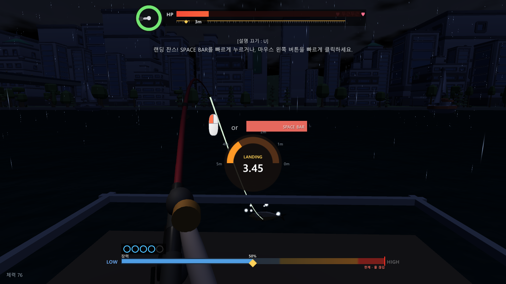
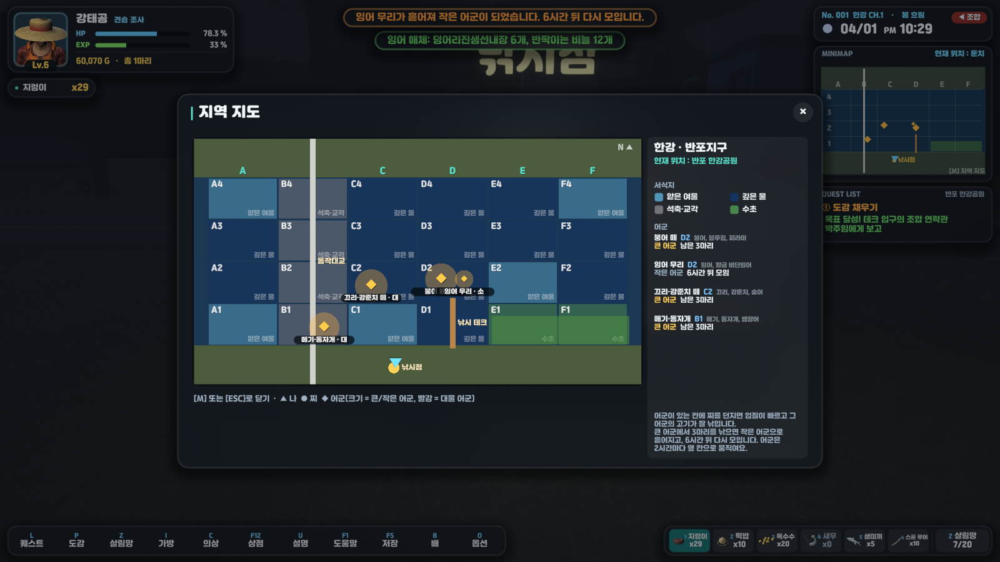

# 02. 게임 디자인

솔로 플레이용 청풍명월 리메이크. 이번 버전의 맵은 **한강(반포지구) 한 곳**이다. 해외 맵은 범위 밖이다.
조작과 화면 구성은 원작 플레이 영상(2012년 한강 CH.4, 잉어 44.35cm)과 스크린샷을 프레임 단위로 보고 맞췄다. 자세한 비교는 [01-original-research.md](01-original-research.md#플레이-영상-분석)에 있다.


## 1. 핵심 루프

```
한국 낚시 조합(대기실) ─▶ 낚시터 목록(한국 지도) ─▶ 한강 CH.1~5 입장
                                                         │
필드 이동 ─▶ 캐스팅(당겼다 밀기) ─▶ 대기(예신) ─▶ 본신 ─▶ 챔질(누른 채 흔들기, BAD~PERFECT)
   ▲                                                                   │
   │                                                                   ▼
   │                          파이팅(감기/풀기/방향, 카운터) ─▶ 랜딩 찬스(연타) ─▶ RESULT
   │                               │                                       │
   │                               └─ 실패(줄 끊김 / 바늘 빠짐 / 줄 다 풀림)    │
   └──── 살림망 보관 / 방생 ◀──── 경험치·도감·퀘스트 ◀──────────────────────┘
          │
          └─▶ 상점에서 판매 → 장비·미끼 구매 → 더 큰 고기
```

## 2. 조작 (원작 단축키)

| 상황 | 입력 | 동작 |
|---|---|---|
| 필드 | WASD / Shift / Space | 이동 / 달리기 / 점프 |
| 필드 | B | 물가에서 배 꺼내 타기 / 물가에 대고 내리기 |
| 필드 | F | 가까운 NPC(3.5m 안)와 대화 |
| 배 | W / S / A / D | 앞으로(가속) / 감속·후진 / 왼쪽·오른쪽. 멈추면 뱃머리에 서서 그대로 낚시 |
| 필드 | 오른쪽 버튼 드래그, 휠 | 시점 회전, 줌 (어깨 너머 3인칭) |
| 필드 | **왼쪽 버튼 누르고 아래로 당김 → 빠르게 위로 밀며 놓기** | 캐스팅 |
| 필드 | 1~6 | 미끼 선택 (하단 퀵슬롯 클릭도 가능) |
| 필드 | L / P / Z / F12 | 퀘스트 / 도감 / 살림망 / 상점 (원작과 같은 키) |
| 필드 | M | 지역 지도 (격자, 서식지, 어군, 내 위치·찌 위치) |
| 대기실 | 오른쪽 아래 버튼, L / P / Z / F1 | 낚시터 선택·퀘스트·납품(상점)·거점 이동 / 단축키 창 |
| 어디서나 | U | 설명(튜토리얼 안내문) 켜기/끄기. 원작 `[설명 끄기 : U]` |
| 필드 | F1 / F5 / Esc | 도움말 / 저장 / 창 닫기 |
| 대기·본신 | **왼쪽 버튼 누른 채 좌우로 흔들기** | 챔질 |
| 대기 | 왼쪽 버튼 누르고 있기 (흔들지 않고) | 릴 감기: 찌가 릴 속도로 다가온다. 감는 동안 입질 시계가 멈추고, 놓았을 때 칸·소용돌이 안팎이 바뀌었으면 그 자리에서 새로 기다린다. 발밑 3m까지 감으면 회수 |
| 대기·본신 | R 또는 이동 | 찌 회수 |
| 파이팅 | 왼쪽 버튼 (누르고 있기) | 줄 감기: 장력↑ 거리↓ |
| 파이팅 | 오른쪽 버튼 (누르고 있기) | 줄 풀기: 장력↓ 거리↑ |
| 파이팅 | 마우스 좌우 | 낚싯대 방향 / 화살표 방향으로 빠르게 휙 = 카운터 |
| 랜딩 찬스 | Space 또는 왼쪽 버튼 **연타** | 0m까지 끌어오기 |
| 결과 | 버튼 클릭 (Enter/Space는 1.2초 뒤부터) | 살림망에 넣기 / 방생하기 |

화면 아래 메뉴 바(퀘스트 L, 도감 P, 살림망 Z, 상점 F12, 설명 U, 도움말 F1, 저장 F5)와 미끼 퀵슬롯은 마우스로도 누를 수 있다.

## 3. 캐스팅


원작 안내문: *"왼쪽 버튼을 누르고 당긴 다음 빠르게 밀면서 버튼을 놓으면 캐스팅 됩니다."*

- 왼쪽 버튼을 누르는 동안 마우스를 **아래로 당긴 양**(`PullBack`)을 모은다. `PullFull = 10`(Mouse Y 축 단위, 약 100px)이면 최대다.
- 버튼을 놓는 순간 **최근 0.15초 동안 위로 민 양**을 잰다. `PushFull = 32`(약 320px)이면 최대다.
- `위력 = clamp01(민 양 / 32) × Lerp(0.55, 1, clamp01(당긴 양 / 10))`
- `비거리 = Lerp(4m, 낚싯대 비거리, 위력)`
- 당기는 동안에는 낼 수 있는 최대 비거리를 미리 보여 준다. 화면 가운데에 큰 숫자(예: `12.68m`)가 뜨고, 수면에 하늘색 궤적 리본과 착지 링, 발밑에 하늘색 원이 생긴다. 던진 뒤에도 숫자가 1.6초 동안 남는다.
- 물이 아닌 곳으로는 던질 수 없다. 낚시 데크 끝에서 던지면 2~3행의 깊은 물까지 닿는다.

## 4. 입질과 챔질

### 어떤 고기가 무나 (`BiteSelector`)
찌가 떨어진 **격자 칸**에서 다음 정보를 모아 어종을 정한다.

| 요소 | 가중치 |
|---|---|
| 희귀도 | ★0(잡동사니) 0.25, ★1 1.0, ★2 0.55, ★3 0.25, ★4 0.1, ★5 0.025 |
| 서식지 일치 | ×1 / 불일치 ×0.12 |
| 미끼 일치 | ×1 / 불일치 ×0.15 |
| 활동 시간대 | ×1 / 아니면 ×0.3 |
| 선호 날씨 | ×1.3 |
| 큰 어군 안 + 어군 어종 | ×4 |
| 작은 어군 안 + 어군 어종 | ×2 |

- **대기 시간**: 5~14초. 큰 어군 안이면 ×0.5, 작은 어군 안이면 ×0.75, 하얀 소용돌이 한가운데(반지름 ×1.3 안)면 추가로 ×0.7, 맞는 미끼가 아예 없으면 ×1.6.
- **길이**: `Lerp(min, max, rand^2.2)`. 대부분은 작고 가끔 크다. 어군 어종이면 지수가 큰 어군 1.7, 작은 어군 2.0이라 큰 고기가 더 잘 나온다.

### 찌 클로즈업 게이지


원작 안내문: *"왼쪽 버튼을 누른 상태로 좌우로 흔들어 챔질하세요. 물에 완전히 잠겼을 때 흔들면 퍼펙트"*

- 대기 중에는 화면 오른쪽에 **찌 클로즈업**이 뜬다: 하늘색 물, 줄무늬 찌톱, 오른쪽에 BAD / SO SO / GOOD / GREAT / PERFECT.
- **예신**: 0~3회(공격적인 어종은 0~1회) 찌가 살짝 깔짝인다. 이때 흔들면 **헛챔질**이다(50% 확률로 미끼 소모, 대기 시간 ×1.3로 다시 기다림).
- **본신**: 낚싯대 끝에 빨간 `!` 경보가 뜨고, 찌가 1.1초에 걸쳐 끝까지 잠긴다. 완전히 잠긴 뒤 0.6초가 지나면 고기가 미끼만 따먹고 간다.
- **흔들기 판정**: 왼쪽 버튼을 누른 채 `|Mouse X|` 누적량(초당 6배 감쇠)이 14를 넘으면 한 번 판정한다. 다시 판정하려면 버튼을 뗐다가 눌러야 한다.
- **등급**은 화면에 보이는 찌 잠김(`Bobber.SinkAmount`)으로 정한다.

| 잠김 | 등급 | 결과 |
|---|---|---|
| < 0.2 | BAD | 헛챔질 |
| < 0.45 | SO SO | 바늘 걸림 시작값 낮음 (hookQuality 0.25) |
| < 0.7 | GOOD | 0.5 |
| < 0.97 | GREAT | 0.75 |
| ≥ 0.97 | **PERFECT** | 1.0 + **카운터 콤보 1개 보너스** |

- 바늘 걸림(파이팅 레벨) 시작값 = `Lerp(50, 100, hookQuality)`
- **두근두근**: 대물(대물 기준 길이 이상)이거나 ★4 이상이면 하트가 뛰고 심장 소리가 난다.


## 4-1. 낚시법: 루어 · 플라이 · 트롤링

원작 개발자 인터뷰가 계획으로 말했던 낚시법을 솔로판에 넣었다. 미끼 종류로 대기 방식이 바뀐다 (`FishingController.UpdateLureWait`).

| 낚시법 | 미끼 | 대기 방식 |
|---|---|---|
| 찌낚시 (기본) | 지렁이·떡밥·크릴 … | 찌가 떠서 기다린다. 예신(깔짝)과 본신. 감는 동안은 입질 시계가 멈춘다 |
| **루어** | 스푼 루어, 에기(서천) | 찌 대신 루어. **좌클릭으로 감는 동안만 입질 시계가 간다**(가만히 두면 0.12배). 감으면서 **마우스를 위로 툭 = 액션(저킹)**: 입질이 1.2초(에기 1.6초) 당겨지고 "액션!"이 뜬다. 예신 없이 덥석 문다. 발밑까지 감으면 다시 던진다 |
| **플라이** | 플라이(털바늘, 한강) | 루어처럼 감으며 액션을 주지만, **흘려 두어도 0.55배로 문다**(수면에 뜨는 미끼). 피라미·끄리·강준치·블루길. **플라이 낚싯대**(Lv.6)로 하면 1.3배 |
| **트롤링** | 루어·생미끼, 배 위 | 던져 둔 채로 배를 몰 수 있다. 줄이 배 뒤로 끌려가고 입질 시계 1.6배. 14km/h보다 빠르면 루어가 튀어서 안 문다. 입질이 오면 배가 선다 |

- 루어 대기 중에는 찌 게이지가 없고, 입질이 오면 평소처럼 좌우로 흔들어 챔질한다.
- 루어를 무는 어종: 쏘가리·배스·농어·광어·고등어·참돔 … (`FishSpecies.Baits`에 Lure), 에기는 주꾸미·갑오징어, 플라이는 피라미·끄리·강준치·블루길.


## 5. 파이팅 (`FishFight`)


원작 HUD 배치를 따른다.
- 왼쪽 위: 파이팅 레벨 링. 가운데 릴 손잡이는 감을 때 돈다. 위험할 때와 카운터 찬스에는 빨갛게 바뀐다.
- 위: 주황→노랑 HP 바. 그 아래 눈금자 위의 ◆ 마커와 `14m` 라벨이 거리를 나타낸다(릴 권사량 기준).
- 가운데 위: `[설명 끄기 : U]`와 상황별 원작 안내문.
- 물고기 위치에 **데미지 숫자**가 0.55초마다 떠오른다. 카운터 데미지는 크고 금색이다.
- 아래: 카운터 콤보 구슬 5개(어두운 상자), `LOW ─── HIGH` 장력 바와 ◆ 마커.

### 상태 변수

| 변수 | 범위 | 의미 |
|---|---|---|
| `HP` | 0 ~ MaxHP | 물고기 체력. `MaxHP = 체력배율 × (길이/10)^1.5 × 12.5` |
| `Distance` | m | 바늘까지 거리. 릴 권사량을 넘으면 실패 |
| `Tension` | 0 ~ 1.25 | 줄 강도 대비 장력. 1을 넘으면 위험 |
| `Hook` | 0 ~ 100 | 파이팅 레벨(바늘 걸림). 0이면 바늘이 빠진다 |
| `FishX` | -1 ~ 1 | 화면상 물고기 좌우 위치 |
| `RodX` | -1 ~ 1 | 낚싯대 좌우 방향 (마우스) |
| `Combo` | 0 ~ 5 | 카운터 연속 횟수 (PERFECT 챔질이면 1에서 시작) |

### 물고기 AI
`Run`(좌우로 달림), `Rest`(쉼, 중앙으로 복귀), `Burst`(질주) 세 가지 기분을 오간다.

- 당기는 힘 `Pull = 어종 힘 × (0.45 + 0.75 × 길이/최대길이) × 기분 배율 × 지침 × 흔들림`
  - 기분 배율: Run 1.0, Burst 2.1, Rest 0.3
  - 지침: `Lerp(0.3, 1, HP/MaxHP)`, HP가 0이면 0.12
- Burst 확률은 기분이 바뀔 때마다 `0.25 × 공격성`.
- 화면 끝(|FishX| = 1)에 1.6초 이상 붙어 있으면 방향을 바꾼다.

원작 안내문: *"물고기가 도망가는 반대 방향으로 당겨주세요. 물고기가 한쪽으로 몰리면 도망가기 쉽답니다."*
물고기가 한쪽으로 달리면(|FishX| > 0.4) 그쪽 화면 끝에 **빨간 꺾쇠**가 깜빡이고, 반대로 끌라는 마우스 안내가 뜬다.

### 장력
```
opposition = clamp01(0.5 - RodX × FishX × 0.9)      // 물고기 반대쪽으로 버틸수록 1
raw        = Pull × (0.55 + 0.45 × opposition) + (감기 ? 0.33 × 릴속도/3 : 0)
raw       *= 풀기 ? 0.45 : 1
raw       *= 1 - 0.2 × Flex                          // 연조대는 충격 흡수
target     = raw / 줄 강도
Tension    → target 으로 지수 보간, 속도 Lerp(7, 4, Flex)  // 경조대일수록 빨리 튄다
```

- **드래그 장력** (원작 플레이 감각, 사용자 제보): 마우스를 **물고기 반대쪽으로 끌면** 줄을 당기는 것이라 장력이 쌓이고, **물고기 쪽으로 끌면** 줄이 늦춰진다. 낚싯대가 화면 끝까지 가도 계속 끌면 장력은 계속 올라 한계(100%)를 넘으면 끊어진다.
  ```
  drag      = -MouseDX × FishSide                 // + = 물고기 반대쪽으로 당김
  DragLoad  = clamp(DragLoad + drag × 0.006, -0.45, 0.6) × e^(-1.6·dt)
  target   += DragLoad × (1 - 0.25 × Flex)         // 연조대는 덜 튄다
  ```
  카운터에 성공하면 DragLoad는 0으로 돌아간다. 장력 바에는 `장력` 이름, 현재 %, 오른쪽 끝 빨간 `한계 · 줄 끊김` 선이 있고, 위험하면 `◀◀ 물고기 쪽으로 끌어 늦추기` 안내가 깜박인다.
- **낚싯대 휨** (`TelescopicRod.Drive`): 낚싯대가 **낚싯줄 방향(물고기 쪽)**으로 휜다. 휨각 = `장력^0.8 × Lerp(50°, 85°, Flex)`(장력 1을 넘으면 더 꺾인다). 마디별 비율은 `(i/n)^Lerp(2.4, 1.3, Flex)`라서 경조대는 끝만, 연조대는 손잡이 쪽까지 휜다. 덜 감쇠된 스프링(강성 140, 감쇠비 0.32)으로 따라가서 장력이 튀면 출렁이고, 물고기가 질주(Burst/Run)하면 초릿대가 떨린다.
- **화면 테두리 경고** (원작 영상 9lCHAypXClQ): 장력이 HIGH(0.6) 구간이면 화면 가장자리가 옅게 붉어지고(최대 알파 0.3), 위험(0.9 이상)이면 진한 빨강으로 맥박치듯 번쩍인다(`0.6 + 0.35·|sin 9t|`). `FightHudView.UpdateVignette`

### 거리
```
풀어주는 양 = 풀기 ? Pull × 3.5 + 1 : max(0, Tension - 0.85) × 10   // 드랙이 미끄러짐
감는 양     = 감기 ? 릴속도 × 체력계수 × clamp01(1.15 - Pull × 0.6) : 0
Distance  += (풀어주는 양 - 감는 양) × dt
```

원작 안내문: *"체력이 높은 물고기를 5m안으로 당겨오면 물고기가 도망가게 됩니다."*
- HP가 20%를 넘는 물고기가 5m 안으로 들어오면 **놀라 도망간다**: 1.2초 동안 질주하고, 장력이 +0.25 튀고, 초당 9m씩 멀어진다. 8m 밖으로 나가야 다시 도망갈 수 있다.

원작 안내문: *"물고기와의 거리가 멀어지면 놓치게 됩니다. 거리를 좁히세요."*
- 거리가 릴 권사량의 70%를 넘으면 화면에 큰 거리 숫자(예: `22.87m`)가 뜬다.

### 바늘 걸림 (파이팅 레벨)
- Tension < 0.12(줄이 느슨함): 초당 -14
- 0.12 ≤ Tension < 0.9: 초당 +3 (최대 100)
- 질주 중 Tension > 0.9: 초당 -5 추가

### 데미지
```
구간 배율: Tension < 0.25 → 0.25 | < 0.6 → 0.75 | < 0.9 → 1.3 (하이텐션) | 이상 → 1.6
dmg/s = 8 × 낚싯대 힘 × 구간 배율 × (0.6 + 0.8 × opposition) × 체력계수 × 내구도계수
```
**하이텐션(주황 구간)을 유지하는 게 핵심**이다. 빨강 구간은 데미지가 가장 크지만 곧 끊어진다.

### 카운터


원작 안내문: *"화살표 방향으로 낚시대를 빠르게 당겨주세요! 카운터로 질주하는 물고기를 멈출 수 있어요."*

- **카운터 찬스**: 물고기가 **질주(Burst) 중이고 |FishX| > 0.3**이거나, **한쪽 끝에 몰렸을 때**(|FishX| ≥ 0.78). 쿨다운 0.8초.
- 화면: 회전하는 속도선, 당겨야 할 쪽 끝의 **큰 파란 화살표**, 좌우 마우스 안내, 파이팅 레벨 링이 빨개짐.
- 입력: 최근 0.15초의 마우스 이동 합이 **화살표 방향**(= 물고기 반대쪽)으로 12 이상. 대략 120px 이상 빠르게 휙.
- 효과: `MaxHP × (0.07 + 0.02 × Combo) × 낚싯대 힘` 데미지, Combo +1(최대 5), 물고기 1.3초 휴식, 방향 반전, 장력 ×0.6
- 연출: `COUNTER xN`, 카메라 흔들림, 큰 물보라, 금색 데미지 숫자, 효과음


### 실패 조건
| 실패 | 조건 |
|---|---|
| 줄 끊김 | Tension > 1이 0.4초 이상 지속되거나 Tension > 1.25 |
| 바늘 빠짐 | Hook ≤ 0 |
| 줄 다 풀림 | Distance > 릴 권사량 |

### 랜딩 찬스


원작 안내문: *"랜딩 찬스! SPACE BAR를 빠르게 누르거나, 마우스 왼쪽 버튼을 빠르게 클릭하세요."*

- `HP ≤ 20%`이고 `Distance ≤ 5m`이면 자동으로 랜딩 찬스에 들어간다. 심장 소리가 나고, 5m→0m 다이얼과 `LANDING 3.42` 숫자가 뜬다.
- 한 번 누를 때마다 0.32m × 체력계수만큼 당긴다.
- 물고기는 초당 `0.5 + 기본힘 × Lerp(0.3, 1, HP비율) × 1.2`m씩 버틴다. 초당 4~5번 이상 눌러야 끌려온다.
- 0m에 닿으면 성공. 5.5m 밖으로 밀려나면 다시 파이팅으로 돌아간다.

### RESULT


- 위쪽 기록 바: `WR` 한강 최대 길이 · `TR` 대물 기준 · `MR` 개인 기록(일차)
- 큰 `RESULT` 제목, 물 위로 튀어 오르는 물고기와 물방울, 개인 신기록 표시
- 오른쪽 아래: 어종 이름(초록), `EXP`, `cm`, `kg`, 희귀도 색 엠블럼, 대물이면 `대물 / EXP+100%` 배지
- `[살림망에 넣기 (판매가)]` `[방생하기 (EXP+30%)]`

## 6. 캐릭터 체력

- 최대 100. 시간이 흐르면 게임 1시간마다 약 1씩 준다.
- 파이팅 중에는 초당 0.35, 하이텐션(≥0.6)이면 `+1.8 × Tension`을 더 소모한다.
- **30 미만이면 지침**: 감는 속도와 데미지가 ×0.65.
- 0이면 캐스팅할 수 없다.
- 회복 방법:
  - 살림망(Z) 물고기 **요리**: `clamp(무게g / 25, 5, 60)`
  - **김밥**: +40 (상점 F12에서 500골드)
  - **레벨업**: 가득 찬다

## 7. 성장

- **경험치**: `어종 경험치 × sqrt(길이/최소길이) × (대물이면 2)`. 방생하면 30%를 더 준다.
- **레벨업 필요 경험치**: `100 × level^1.5`. 만렙 25 (원작 초기 한국 코스와 같다).
- **판매가**: `어종 기본가 × (길이/최소길이)^1.2`
- **낚싯대 내구도**: 파이팅마다 `Lerp(0.5, 3, 길이/100)`만큼 줄고, 위험 장력으로 끝나면 ×1.5. 0이면 데미지가 절반이 된다. 수리비는 1포인트당 8골드.

## 8. 장비

| 종류 | 이름 | 레벨 | 가격 | 성능 |
|---|---|---|---|---|
| 낚싯대 | 입문용 민물대 | 1 | 기본 | 힘 1.0, 연조 0.8, 18m |
| 낚싯대 | 카본 경질대 | 4 | 3,000 | 힘 1.4, 경조 0.3, 22m |
| 낚싯대 | 명품 대나무 연질대 | 8 | 12,000 | 힘 1.5, 연조 0.75, 20m (안정형) |
| 낚싯대 | 헤비 원투대 | 12 | 25,000 | 힘 2.0, 경조 0.35, 32m (공격형) |
| 릴 | 기본 스피닝 / 파워 / 하이기어 | 1 / 5 / 10 | 기본 / 5,000 / 15,000 | 3.0 / 4.2 / 5.5 m/s, 60 / 90 / 120m |
| 줄 | 나일론 2호 / 카본 3호 / 강사 줄 PE 4호 | 1 / 3 / 8 | 기본 / 1,500 / 6,000 | 강도 1.0 / 1.3 / 1.7 |

미끼는 지렁이, 떡밥, 옥수수, 새우, 생미끼, 스푼 루어 6종이다. 챔질에 성공하거나 미끼를 따먹히면 1개씩 소모된다.

**낚싯대와 릴의 모양** (`TelescopicRod`): 민물 뽑기대처럼 빗자루 길이의 손잡이 마디 안에 가는 마디들이 들어 있다가 끝 마디부터 하나씩 뽑혀 나온다(낚시터에 들어갈 때 1.2초, 마디마다 '착' 소리). 대기실에서는 접어서 들고 있다. 끝으로 갈수록 가늘고, 이음매마다 금속 링(페룰)과 줄 고리(가이드)가 있다.

| 장비 | 모양 |
|---|---|
| 입문용 민물대 | 빨강, 4마디, 3.0m |
| 카본 경질대 | 검정 카본·금색 링·코르크 손잡이, 5마디, 3.2m |
| 명품 대나무 연질대 | 대나무색·갈색 마디, 5마디, 3.0m |
| 헤비 원투대 | 남색·굵음, 4마디, 3.6m |
| 기본 스피닝 릴 | 은색 |
| 파워 릴 | 검정·금색, 20% 큼 |
| 하이기어 릴 | 파랑·은색, 손잡이 2개 |

릴은 감을 때(좌클릭) 손잡이가 돌고 로터가 기어비 5.2:1로 돌며 스풀이 오르내린다. 줄이 풀려 나가면(우클릭, 드랙 미끄러짐, 물고기 질주) 스풀이 거꾸로 돈다. 1인칭에서는 왼손(장갑)이 손잡이 끝에 붙어 같이 돈다.

**손맛 소리** (`SoundFx`, 모두 절차적으로 생성):
- 릴 감기 루프(드르르륵): 감는 속도·장력에 따라 높아지고 커진다
- 드랙 루프(지이이익): 줄이 풀려 나가는 속도(m/s)에 비례
- 낚싯대 버팀(끼익): 장력이 HIGH를 넘으면
- 카운터: 휙 → 쿵 → 팅(줄 튕김) → 짧은 드랙, 콤보마다 조금씩 높아짐. 이때 낚싯대가 확 휘었다 튕겨 돌아온다(`Kick`)
- 예신·본신 때 3인칭 낚싯대 초릿대가 톡 / 쭉 휜다

**미끼 만들기** (원작 영상 2Mvir9jZ-28): 살림망(Z)에서 **20cm 미만**의 작은 고기(잡동사니 제외)는 `미끼` 버튼으로 **생미끼**로 바꿀 수 있다. 10cm 미만이면 2개, 그 이상이면 3개. 생미끼는 쏘가리·끄리·메기·강준치 같은 육식어가 좋아한다. (`PlayerProfile.CanMakeBait`, `BaitFromFish`)

## 9. 한강 맵

- 강은 X축을 따라 흐른다(320m × 120m). 남쪽 둔치에서 시작하고 북쪽은 아파트 단지와 남산 타워 배경이다.
- 수면은 **50m × 30m 격자**(A~F열, 1~4행)로 나뉜다. 1행이 남쪽 둔치에 붙어 있다.

| 행\열 | A | B (동작대교) | C | D (낚시 데크) | E | F |
|---|---|---|---|---|---|---|
| 1 | 얕은 여울 | 석축·교각 | 얕은 여울 | 깊은 물 | 수초 | 수초 |
| 2 | 깊은 물 | 석축·교각 | 깊은 물 | 깊은 물 | 얕은 여울 | 깊은 물 |
| 3 | 깊은 물 | 석축·교각 | 깊은 물 | 깊은 물 | 깊은 물 | 깊은 물 |
| 4 | 얕은 여울 | 석축·교각 | 깊은 물 | 깊은 물 | 깊은 물 | 얕은 여울 |

- 주요 지점: 낚시점 건물(시작 위치 옆, 상점은 F12로 어디서나 열림), 낚시 데크(D열, 강 쪽으로 36m 뻗은 잔교), 동작대교 교각(B열, 쏘가리·뱀장어), 동쪽 수초 만(E1·F1, 붕어·가물치)
- **어군 4개**: 붕어 떼, 잉어 무리, 끄리·강준치 떼, 메기·동자개. 원작처럼 칸 안의 한 자리에 **실제 시간 5~10분** 머물며 수면에 **하얀 소용돌이**(큰 어군 반지름 3.5m, 작은 어군 2.2m, 대물 어군 4.5m)를 남기고, 그 안에서 가끔 고기가 튀어 파문이 생긴다. 머무는 시간이 끝나면 이웃 칸으로 옮기고 소용돌이는 3초에 걸쳐 사라졌다가 새 자리에서 떠오른다. 선호 시간대에는 둔치 쪽(1~2행), 아니면 깊은 쪽(2~3행)으로 간다. 미니맵의 `◆`는 소용돌이 자리를, 지역 지도는 칸을 보여 준다. (`FishSchool.Spot`, `SchoolSwirlFx`)
- **큰 어군 / 작은 어군** (원작 영상 2Mvir9jZ-28): 어군은 처음에 **큰 어군**이다. 큰 어군 칸에서 그 어군의 어종을 **3마리** 낚으면 흩어져 **작은 어군**이 된다(입질 배율 ×4 → ×2, 대기 ×0.5 → ×0.75, 파문도 작고 드물어짐). 작은 어군은 게임 시간 **6시간** 뒤 다시 큰 어군으로 모인다. 미니맵의 `◆` 크기와 지역 지도의 원 크기로 구분한다. (`FishSchool.Big`, `FishSchoolManager.OnCatch`)
- **지역 지도 (M)**: 원작의 지역 지도(홍현 앞바다 A~H/1~8 격자)처럼 A~F/1~4 칸을 서식지 색으로 칠하고, 칸 이름·서식지, 동작대교·낚시 데크·낚시점, 어군(큰/작은, 남은 마릿수, 다시 모이기까지 남은 시간), 내 위치(▲)와 찌(●), 찌가 있는 칸을 보여 준다. (`AreaMapPanel`)



## 9-4. NPC와 퀘스트 보고

NPC에게 다가가면 `[F] ○○과/와 대화` 안내가 뜬다. 대화하는 동안 NPC가 나를 돌아보고, 카메라가 어깨 너머로 NPC를 비추며, 이름표는 숨긴다(대화창에 이름이 나온다).

| NPC | 위치 | 대화 |
|---|---|---|
| 낚시점 김사장 | 낚시점 카운터 | 물건 사고팔기(상점), **낚싯대 강화**, 오늘 조황. 인사말이 시간대·날씨·강화 단계에 따라 바뀐다 |
| 조합 연락관 박주임 | 낚시 데크 입구 | 지금 퀘스트와 진행도, **목표를 채웠으면 보고하고 보상 받기**, 조황 |
| 한강도사·수초요정·새벽조사·뗏목 낚시꾼 | 둔치·뗏목 | 낚시 요령 한마디, 조황 |

- **조황**은 실제 게임 상태에서 뽑는다: 지금 시간대에 활발한 어군의 이름, 칸(A1~F4), 큰/작은 어군, 그 어군 대표 어종이 좋아하는 미끼. 배가 없으면 "3~4행은 배로" 힌트.
- **퀘스트 보고**: 목표를 채우면 바로 보상이 나오지 않고 "보고 대기"가 된다(HUD 퀘스트 칸이 초록 글씨로 바뀜). 박주임과 대화하거나 대기실(한국 낚시 조합)의 퀘스트 창에서 보고하면 보상을 받고 다음 퀘스트가 열린다.

## 9-5. 장비 강화 (낚싯대 · 릴, `RodUpgrade`)

원작 개발실장 인터뷰 기준: 낚싯대와 릴을 강화하고, 재료는 낚시로 얻으며(해체해서 나온 **반짝이는 비늘**), 낚시점 주인에게 맡긴다. 최대 **+15**, 실패해도 장비는 깨지지 않는다. 강화 단계는 장비마다 따로 저장된다(`SaveData.rodLevels`).

| 현재 단계 | 0 | 1 | 2 | 3 | 4 | 5 | 6 | 7 | 8 | 9 | 10 | 11 | 12 | 13 | 14 |
|---|---|---|---|---|---|---|---|---|---|---|---|---|---|---|---|
| 성공 확률 | 100% | 95% | 90% | 85% | 80% | 70% | 62% | 55% | 48% | 42% | 36% | 30% | 25% | 20% | 15% |

- 낚싯대: 단계마다 **힘 +3%**, **비거리 +0.4m**. 릴: **감기 속도 +2.5%**, **권사량 +5m**. +15면 낚싯대 힘 1.45배 (밸런스 5차 조정, [04-balance.md](04-balance.md)).
- 비용: 골드 `(150 + 장비 가격 × 0.05) × (단계+1)^1.5` (10골드 단위) + 반짝이는 비늘 `1 + 단계/2`개.
- **별모래**를 넣으면 성공 확률 +15% (최대 95%).
- 실패: 보통은 재료만 잃고, **+7 이상에서 실패하면 10% 확률로 한 단계 떨어진다**.
- 강화한 장비는 상점·강화 창에 `+N`으로 표시된다.


## 9-2. 배

원작 영상(9lCHAypXClQ 4:30~5:30): 바닷가로 걸어가 배를 꺼내 타고, 오른쪽 아래 속도계·연료계를 보며 달린 뒤 멈춰서 뱃머리에서 낚시한다. 솔로판 한강에서는 이렇게 한다.

- **장비**: 낚시점(F12) 장비 목록의 "배". 산 배는 장착 칸(`SaveData.boatId`)에 들어가고 연료가 가득 찬 채로 시작한다.

| 배 | 레벨 | 가격 | 최고 속도 | 연료통 | 연비 | 안정성 | 먼바다 |
|---|---|---|---|---|---|---|---|
| 고무보트 | 3 (Lv.5 지급) | 4,000 | 22km/h | 20L | 83m/L | ★★ (0.3) | 못 감 |
| 돛단배 | 8 | 18,000 | 32km/h × 바람 | 없음 | — | ★★★ (0.5) | 감 |
| 고속보트 | 10 | 30,000 | 50km/h | 40L | 50m/L | ★★★ (0.55) | 감 |
| 낚시 크루저 | 14 | 60,000 | 40km/h | 80L | 40m/L | ★★★★★ (0.9) | 감 |

- **돛단배**: 연료 없이 바람으로 달린다. 속도 = 최고 속도 × 바람 배율 0.2~1.1 — 옆바람(바람과 90°)이 가장 빠르고, 뒤바람은 조금 느리고, 맞바람 쪽(135° 넘게)은 거의 못 간다. 바람이 셀수록 빠르다. 돛이 바람 쪽으로 돌고 옆바람이면 배가 기운다. FUEL 계기판 자리에 바람 세기(m/s)와 지금 방향이 얼마나 좋은지가 나온다.
- **바람** (`WeatherSystem.WindYaw/WindSpeed`): 게임 시각에 따라 방향이 천천히 돌고, 세기 2~7m/s (흐림 +1.5, 비 +4).
- **흔들림 (배 안정성)**: 파도 = 바다 1 / 강 0.45 × (0.7 + 바람/8 + 비 0.4), 먼바다는 1.4배. 흔들림 폭 = 파도 × (안정성이 낮을수록 크게: 고무보트 약 1.7배 ~ 크루저 0.5배). 오르내림·앞뒤·좌우 기울기 모두.
- **크루저**: 선장(김선장)과 동행 꾼이 함께 탄다 (원작 온라인판은 최대 10명 승선).
- **먼바다 포인트** (`FieldMapDef.IsFarSea`): 바다 맵 격자 6행 이후. 파도가 높아 **고무보트로는 못 나가고**, 찌를 먼바다에 던지면 대물 확률 +8% (캐스팅 칸 표시에 "먼바다 (대물↑)").

- **꺼내기 (B)**: 둔치나 데크 끝에서 물 쪽을 보고 B. 바라보는 방향부터 좌우 15°씩 넓혀 가며 배 몸통(앞·가운데·뒤 × 양옆)이 다 물 위인 자리를 찾아 띄운다. 없으면 "물가에서만…" 안내.
- **운전**: W 가속, S 감속·후진(최고 속도의 40%), A/D 방향(빠를수록 잘 돈다). 몸통이 둑·교각·데크에 걸리면 부딪혀서 튕긴다(물보라, 카메라 흔들림). 달리면 운전석에 앉고(Driving 애니메이션), 카메라가 배 뒤로 천천히 돈다.
- **연료**: 엔진으로 달린 거리만큼 `연비`에 따라 준다. 다 떨어지면 노를 저어 1.2m/s로만 간다. 낚시점 "배 연료 채우기"로 L당 30골드.
- **낚시**: 멈추면(0.35m/s 이하) 뱃머리에 서서 평소처럼 캐스팅한다. 낚시 중에는 배가 움직이지 않는다. W/S/A/D를 누르면 찌를 거두고 다시 운전한다.
- **배로만 닿는 곳**: 둔치에서 최대 비거리(32m)로 던져도 2행까지만 닿는다. 3~4행(강 가운데~건너편)의 깊은 물과 어군은 배로 나가야 노릴 수 있다.
- **내리기 (B)**: 속도를 1.5m/s 아래로 줄이고 물가에 대면, 배 둘레 6m 안에서 가장 가까운 둔치·데크로 내린다. 대기실로 나가면 배를 띄웠던 둔치로 돌아간다. 배 위에서 저장하면 위치는 배를 띄운 둔치로 저장된다.
- **연출**: 파도에 따라 오르내리고 기울며, 빠를수록 뱃머리가 들린다. 뒤로 하얀 물보라 꼬리(TrailRenderer)와 파문, 빠를 때 뱃머리 물보라, 엔진 소리(속도에 따라 높아짐). HUD 오른쪽 아래에 SPEED(km/h)·FUEL(L) 원형 계기판.


## 9-3. 초상화

HUD 왼쪽 위 초상화는 그림이 아니라 **내 캐릭터를 비추는 두 번째 카메라**(`PortraitCamera`)의 화면이다. 캐릭터 모델을 전용 레이어(8)에 두고, 그 레이어만 보는 카메라와 조명 2개(앞쪽 주광, 뒤쪽 푸른 테두리광)로 256×256 렌더 텍스처에 그린다. 옷·모자·머리를 바꾸면 그대로 바뀌고, 밤에도 얼굴이 보인다. 낚싯대는 얼굴을 가리므로 레이어에서 뺀다.

## 9-1. 대기실과 낚시터 목록

- 게임은 **한국 낚시 조합** 실내(원작 대기실 영상 fw1GiQ2KFmQ)에서 시작한다. 목재 벽과 들보, 한반도 지도, 박제 물고기 3마리(잉어·메기·쏘가리), 태극기, 책장, 지구본, 책상과 모니터, 가운데에 내 캐릭터. 카메라는 고정 구도로 아주 천천히 흔들린다. (`LobbyRoom`, 월드 좌표 (0, 0, -420))
- 오른쪽 아래 버튼: **낚시터 선택하기** / 퀘스트 / **납품**(상점) / 거점 이동하기(해외 거점은 아직 없음 안내).
- **낚시터 목록** (원작 화면 그대로): 왼쪽에 KOREA 지명 목록과 한국 지도 마커, 아래 방 목록(No.001~005, 한강 CH.1~5), 오른쪽에 MAP INFO(도감 달성도), FISH INFO(어종 카드 넘기기, 개인 기록), 버튼 빠른입장·방만들기(비활성)·입장하기·나가기. 11곳 중 **한강만 열려 있다**(나머지는 "준비 중"). (`FishingAreaPanel`, `KoreaMap`, `FishingAreas`)
- 필드 HUD 시계 패널의 `↩ 조합` 버튼으로 대기실로 돌아온다. 파이팅·결과 중에는 나갈 수 없고, 던져 둔 찌는 거둔다.


## 9-6. 서천 앞바다 (서해, Lv.6) — `SeocheonMap.cs`

원작 국내 낚시터이자 **조합 낚시 대회가 열리던 곳**(루리웹 소감). 실제 서천 바닷가를 참고했다: 홍원항(바다로 뻗은 방파제와 **흰·빨간 등대**, 국가어항), **춘장대 해변과 갯벌**, 마량리 동백나무숲의 **동백정**(서해 낙조를 보는 정자), 앞바다 바위섬. 주꾸미·갑오징어가 유명하고 가을엔 전어.

| 곳 | 내용 |
|---|---|
| 홍원항 | 호안(콘크리트 벽) 앞은 바로 깊다. ㄴ자로 꺾인 큰 방파제 끝에 빨간 등대, 짧은 방파제 끝에 흰 등대 (항구 입구 오른쪽 빨강·왼쪽 흰색 — 실제 항로 표지 규칙). 어선·부표·가로등 |
| 춘장대 갯벌 | 서쪽 모래 해변에서 바다 쪽으로 완만하게 깊어지는 갯벌과 물골. **썰물이면 드러나서 걸어 들어갈 수 있다** |
| 동백정 | 남쪽 육지에서 바다로 튀어나온 언덕 곶, 바다 쪽은 절벽. 꼭대기에 팔작지붕 정자(붉은 기둥·단청·처마 끝이 들린 기와), 둘레에 붉은 꽃이 핀 동백숲 |
| 바위섬 | 배로 건너가 내려서 낚시 |
| 마을 | 해안도로, 횟집·민박, 언덕 위 집과 소나무, 「서천 주꾸미 축제」 간판 |

- **물때** (`Core/Tide.cs`): 게임 시각 12시간 25분마다 한 번 들고 난다(실제 반일주조 주기). 수면이 ±0.6m 오르내리고 HUD 채널 줄에 `들물 ▲ / 날물 ▼ / 만조 / 간조`가 나온다. **들물이면 입질 대기 0.75배, 정조(만조·간조)는 1.25배**. 갯벌에 서 있다가 물이 들어오면 둔치로 피한다.
- **물빛**: 탁한 황록색 (`FieldMapDef.WaterDeep/WaterShallow`). 해는 바다 쪽으로 진다 → 방파제·동백정에서 바다 위 노을.
- **어종**: 서천에만 — 망둥어, 전어, 백조기(보구치), **주꾸미**, **갑오징어**, **민어**(대물, 어군 전용: 저녁 C5 · 밤 F6). 홍현과 같이 — 우럭, 쥐노래미, 광어, 문치가자미(도다리), 붕장어, 감성돔, 농어, 참돔.
- **미끼 「에기」**: 주꾸미·갑오징어용 새우 모양 가짜 미끼 (서천 낚시점, 5개 1,800골드). 처음 오면 어촌계가 크릴·청갯지렁이·에기를 준다.
- **두족류 모델**: 주꾸미(외투막 + 다리 8개, 눈 아래 금색 고리), 갑오징어(납작한 갑 + 지느러미 치마 + 다리 8 + 촉완 2). 다리마다 뼈 3개로 꿈틀거린다 (`tools/blender/cephalopod.py`).
- **이야기 퀘스트** (그루퍼 다음): 서해 노을(망둥어 3) → 주꾸미 철(주꾸미 3) → 물때를 읽어라(저녁 백조기 2) → 먹물 조심(갑오징어) → 서해의 왕(민어, 살림망 2칸).
- **업적**: 서천 도감 완성(칭호 「서해 박사」), 서해의 왕(민어, 칭호), 주꾸미 박사(10마리).
- **대회**: 날마다 한강 → 서천 → 홍현 순서로 열린다 (13-1).
- NPC: 어촌계 이계장(조합 연락관), 서천 낚시점 박사장, 주꾸미 아줌마, 갑오징어 헌터, 동백정 할아버지.


## 10. 시간과 날씨

- 현실 1초 = 게임 2분 (하루 12분). 새벽 4~7, 아침 7~11, 낮 11~17, 저녁 17~20, 밤 20~4시.
- 해와 달이 돌고, 하늘·안개·주변광이 바뀐다. 밤에는 가로등이 켜지고, 새벽에는 물안개(안개 농도 증가)가 낀다.
- 날씨는 게임 시간 3~7시간마다 다시 정한다: 맑음 55%, 흐림 27%, 비 18%. 비가 오면 어두워지고 빗줄기가 내린다. 겨울에는 비 대신 **눈**이 천천히 날린다.
- 바람: 방향이 천천히 돌고 세기 2~7m/s (흐림 +1.5, 비 +4). 돛단배 속도와 배 흔들림(파도)에 쓴다.

### 10-1. 계절 (`Data/Seasons.cs`, `World/SeasonFx.cs`)

원작은 시간대·눈·비·장마에 따라 어종이 달라졌다. 솔로판은 계절을 체감할 수 있게 **한 달 = 게임 7일**로 줄였다 (1일째가 4월 1일, 한 계절 = 21일 ≈ 현실 4시간).

| 계절 | 달 | 제철 어종 (입질 1.6배, 제철이 아니면 0.35배) |
|---|---|---|
| 봄 | 3~5월 | 붕어·잉어(봄·가을), 주꾸미, 갑오징어, 참돔(봄·가을), 광어·학꽁치(겨울·봄) |
| 여름 | 6~8월 | 메기, 가물치, 뱀장어, 쏘가리(여름·가을), 민어, 농어(여름·가을) |
| 가을 | 9~11월 | 전어, 고등어, 감성돔(가을·겨울) |
| 겨울 | 12~2월 | **빙어** (한강 얼음 구멍에서만) |

- HUD 날짜는 `달/일`(7일을 1·5·9 … 25일로 펼친다), 채널 줄에 계절과 날씨(`겨울 눈`). 대기실 시계에 `N월 계절`.
- **겨울 한강**: 남쪽 둔치 앞 강물 35m가 얼고(`SeasonFx.HanIce`), 둔치에 눈이 덮인다. 얼음 위로 걸어 들어가 **좌클릭하면 발 앞에 구멍을 뚫고 채비를 내린다**(캐스팅 없음). 얼음 구멍에서는 빙어가 주인공(8배), 다른 고기는 0.2배. 감을 줄이 없어 누르고 좌우로 흔들면 바로 챔질. 배는 얼음으로 못 나간다.
- 업적 「얼음 위의 겨울」(빙어).


## 11. 어종 (16종 + 잡동사니 2종)

| 어종 | ★ | 길이(cm) | 대물 | 서식지 | 미끼 | 시간 | 날씨 |
|---|---|---|---|---|---|---|---|
| 붕어 | 1 | 8~42 | 30.3 월척 | 여울, 수초 | 지렁이, 떡밥, 옥수수 | 새벽, 아침, 저녁 | 흐림, 비 |
| 피라미 | 1 | 7~17 | 15 | 여울 | 지렁이, 떡밥 | 아침~저녁 | 전부 |
| 블루길 | 1 | 8~25 | 22 | 수초, 여울 | 지렁이, 떡밥, 새우 | 아침, 낮 | 전부 |
| 끄리 | 1 | 15~38 | 30 | 여울 | 루어, 생미끼, 지렁이 | 아침, 낮 | 맑음 |
| 누치 | 2 | 20~60 | 50 | 여울, 석축 | 지렁이, 새우 | 아침, 낮 | 맑음, 흐림 |
| 강준치 | 2 | 30~90 | 70 | 깊은 물, 여울 | 생미끼, 루어 | 아침~저녁 | 맑음 |
| 숭어 | 2 | 30~80 | 65 | 깊은 물, 여울 | 떡밥, 새우 | 아침, 낮 | 맑음 |
| 배스 | 2 | 20~62 | 50 런커 | 수초, 석축 | 루어, 생미끼 | 아침, 저녁 | 맑음, 흐림 |
| 동자개 | 2 | 12~34 | 28 | 석축, 깊은 물 | 지렁이, 새우 | 저녁, 밤 | 비, 흐림 |
| 메기 | 2 | 25~90 | 70 | 깊은 물, 수초 | 지렁이, 생미끼, 새우 | 저녁, 밤 | 비, 흐림 |
| 잉어 | 3 | 25~105 | 80 | 깊은 물, 수초 | 옥수수, 떡밥, 지렁이 | 새벽, 저녁, 밤 | 맑음, 흐림 |
| 쏘가리 | 3 | 15~55 | 45 | 석축 | 생미끼, 루어, 새우 | 새벽, 저녁, 밤 | 흐림 |
| 가물치 | 3 | 35~100 | 80 | 수초 | 루어, 생미끼 | 낮, 저녁 | 맑음 |
| 뱀장어 | 4 | 40~100 | 85 | 석축, 깊은 물 | 지렁이, 새우, 생미끼 | 밤 | 비 |
| 황금 비단잉어 | 5 | 60~110 | 100 전설 | 깊은 물 | 옥수수, 떡밥 | 새벽 | 맑음, 흐림 |
| 빈 깡통, 낡은 운동화 | 0 | - | - | 어디서나 | - | - | - |

## 12. 도감


- 1마리: 이름, 학명, 성질, 낚은 수, 최대 기록, 길이 범위
- 3마리: 선호 미끼 공개
- 5마리: 활동 시간과 서식지 공개
- 대물 기준을 넘긴 기록에는 대물 이름(월척/대물/런커/전설)이 붙는다.

## 13. 조합 퀘스트

| # | 제목 | 목표 | 보상 |
|---|---|---|---|
| 1 | 첫 손맛 | 아무 물고기 1마리 | 1,000골드, 경험치 50 |
| 2 | 붕어를 찾아서 | 붕어 3마리 | 1,500골드, 경험치 80, 떡밥 20 |
| 3 | 도감 채우기 | 서로 다른 어종 4종 (이미 잡은 것도 인정) | 2,000골드, 경험치 120 |
| 4 | 수초 포인트 | 수초에서 3마리 | 1,500골드, 경험치 120, 옥수수 30 |
| 5 | 밤낚시 | 밤에 메기 1마리 | 3,000골드, 경험치 200 |
| 6 | 교각 아래의 사냥꾼 | 쏘가리 1마리 | 5,000골드, 경험치 300, 생미끼 10 |
| 7 | 월척의 꿈 | 30.3cm 이상 붕어 | 8,000골드, 경험치 400 |
| 8 | 한강의 주인 | 80cm 이상 잉어 | 20,000골드, 경험치 1,000 |

## 13-1. 조합 낚시 대회 (`TournamentRules`, `TournamentSystem`)

원작(게임메카 2012-08 「대회 시스템」): NPC를 통해 참가하고, 하루~이틀마다 정해진 시간에 열리며, 미션(가장 많이 · 가장 길게 · 길이 합계) 포인트를 합쳐 순위를 매긴다. 참가만 해도 포인트를 주고, 누적 포인트로 계급 엠블럼을 준다. 1~3위 보상은 「거거 낚시대」, 「나팔고둥」. 솔로판은 AI 낚시꾼 7명과 겨룬다.

| 항목 | 규칙 |
|---|---|
| 일정 | 매일 09:00~15:00 (게임 시각). 날마다 한강 → 서천 앞바다(Lv.6, 원작 대회 장소) → 홍현 앞바다(Lv.5) 순서. 참가 신청은 08:00부터, 진행 중에도 늦게 참가할 수 있다 |
| 참가 | 조합 연락관(F → [낚시 대회]) 또는 퀘스트 창(L) [대회] 탭 |
| 기록 | 참가하고, 대회 시간에, 대회 맵에서 낚은 고기만 (잡동사니 제외). 참가하면 시간이 절반 속도로 흐른다 (게임 6시간 = 현실 6분) |
| 미션 점수 | 세 미션마다 1위 10 · 2위 6 · 3위 4 · 4위 2 · 그 아래 1점 (기록이 없으면 0). 합계로 순위, 동점이면 길이 합계 |
| AI 낚시꾼 | 한강도사(1.25) · 감생이사냥꾼(1.15) · 새벽조사(1.0) · 붕어왕 김씨(0.95) · 찌맨(0.85) · 루어소녀(0.8) · 주말낚시꾼(0.65). 실력 1.0이 게임 45분에 한 마리, 실력이 높을수록 큰 고기. 날짜로 정해지는 난수라 저장하지 않는다 |
| 보상 | 1위 8,000골드 · 소라고동 5 · **거거 낚시대**(없으면) / 2위 5,000골드 · 소라고동 3 · **나팔고둥 릴**(없으면) / 3위 3,000골드 · 소라고동 2 / 그 밖 500골드. 1~3위가 장비를 이미 받았으면 별모래 1개 |
| 엠블럼 | 누적 포인트 = 참가 3 + 미션 점수. 브론즈 0 · 실버 30 · 골드 80 · 플래티넘 160 · 다이아몬드 300 |
| 업적 | 첫 대회, 시상대(칭호 「입상 조사」), 대회 챔피언(칭호 「대회 챔피언」), 골드 엠블럼 |

- 보상 장비: 거거 낚시대(Lv.10, 힘 1.85, 중연조, 비거리 28m, 진줏빛 흰 몸통), 나팔고둥 릴(Lv.10, 감기 5.0m/s, 권사량 140m, 크림·주황 갈색). 상점에서 팔지 않고, 받은 뒤에는 상점 장비 목록에서 장착할 수 있다.
- 대회 중 HUD: 퀘스트 목록 아래 **TOURNAMENT** 칸에 남은 시간과 1~5위 + 내 순위.
- 15:00이 되면 정산한다. 저장하고 껐다가 다음 날 켜면 켤 때 정산한다.

## 14. 저장

- `Application.persistentDataPath/save.json` (Windows: `%USERPROFILE%\AppData\LocalLow\didrnrgus\Project Fishing - 청풍명월 솔로\save.json`)
- 자동 저장: 60초마다, 결과 선택 후, 종료 시. F5로 수동 저장.
- 에디터 메뉴 `Fishing > Delete Save`로 초기화할 수 있다.
