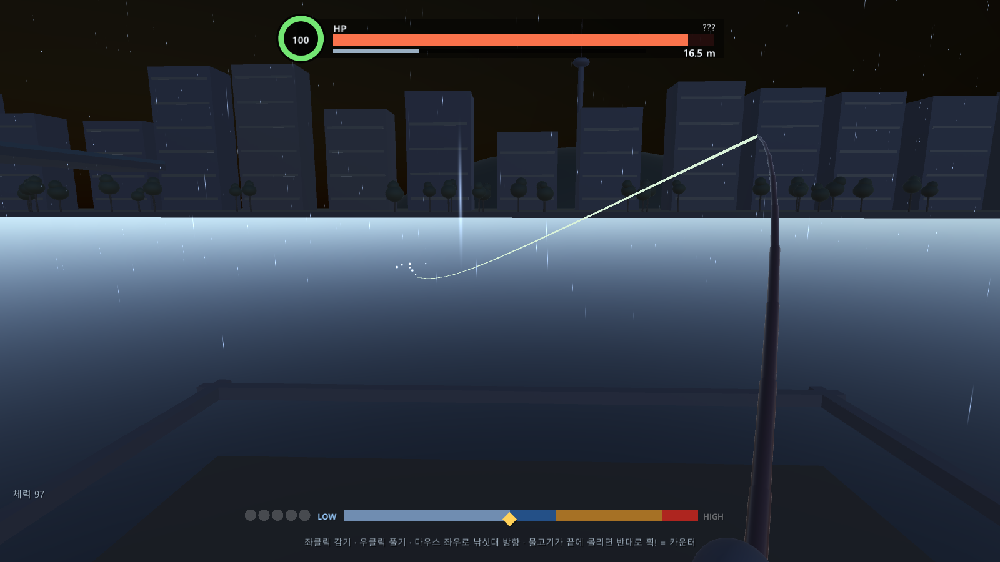
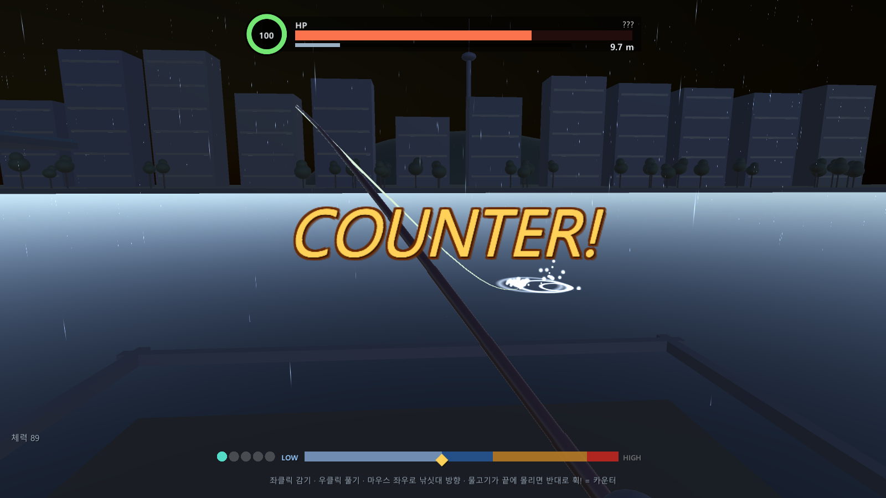
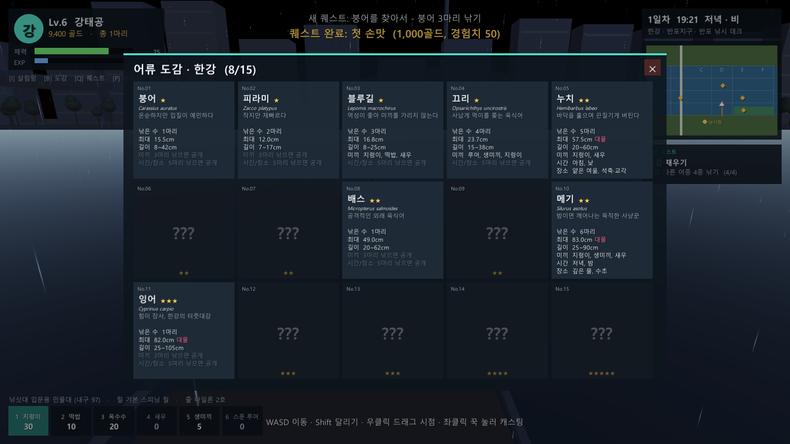

# 02. 게임 디자인

솔로 플레이용 청풍명월 리메이크. 이번 버전의 맵은 **한강(반포지구) 한 곳**이다. 해외 맵은 범위 밖이다.


## 1. 핵심 루프

```
필드 이동 ──▶ 캐스팅 ──▶ 대기(예신) ──▶ 본신 ──▶ 챔질 ──▶ 파이팅 ──▶ 랜딩 ──▶ 결과
   ▲                                                      │              │
   │                                                      └─ 실패(줄 끊김/바늘 빠짐/줄 다 풀림)
   └──── 살림망 보관 / 방생 ◀──── 경험치·도감·퀘스트 ◀─────────────────────────┘
          │
          └─▶ 낚시점에서 판매 → 장비/미끼 구매 → 더 큰 고기
```

## 2. 조작

| 상황 | 입력 | 동작 |
|---|---|---|
| 필드 | WASD / Shift | 이동 / 달리기 |
| 필드 | 우클릭 드래그, 휠 | 시점 회전, 줌 (어깨 너머 3인칭) |
| 필드 | 좌클릭 누르기 → 떼기 | 캐스팅 게이지 왕복 → 던지기 |
| 필드 | 1~6 | 미끼 선택 |
| 필드 | I / B / Q / P / F1 / F5 / Esc | 살림망 / 도감 / 퀘스트 / 낚시점 / 도움말 / 저장 / 창 닫기 |
| 대기 | 좌클릭 | 챔질 (본신 때만 성공) |
| 대기 | R 또는 이동 | 찌 회수 |
| 파이팅 | 좌클릭 (누르고 있기) | 줄 감기: 장력↑ 거리↓ |
| 파이팅 | 우클릭 (누르고 있기) | 줄 풀기: 장력↓ 거리↑ |
| 파이팅 | 마우스 좌우 | 낚싯대 방향 / 빠르게 휙 = 카운터 |
| 파이팅 | Space | 랜딩 (조건 충족 시) |
| 결과 | Enter / Space | 살림망에 넣기 |

## 3. 캐스팅

- 좌클릭을 누르는 동안 `Charge`가 0→1→0으로 **0.9초 주기**로 왕복한다 (`Mathf.PingPong`).
- 비거리 = `Lerp(4m, 낚싯대 비거리, Charge)`. 수면 위에 착지 지점 링이 보인다(초록=물, 빨강=물 아님).
- 물이 아닌 곳으로는 던질 수 없다. 낚시 데크(잔교) 끝에서 던지면 2~3행의 깊은 물까지 닿는다.

## 4. 입질과 챔질

찌가 떨어진 **격자 칸**에서 다음 정보를 모아 어떤 고기가 물지 정한다 (`BiteSelector`).

| 요소 | 가중치 |
|---|---|
| 희귀도 | ★0(잡동사니) 0.25, ★1 1.0, ★2 0.55, ★3 0.25, ★4 0.1, ★5 0.025 |
| 서식지 일치 | ×1 / 불일치 ×0.12 |
| 미끼 일치 | ×1 / 불일치 ×0.15 |
| 활동 시간대 | ×1 / 아니면 ×0.3 |
| 선호 날씨 | ×1.3 |
| 어군 안 + 어군 어종 | ×4 |

- **대기 시간**: 5~14초. 어군 안이면 ×0.5, 맞는 미끼가 아예 없으면 ×1.6.
- **예신(깔짝)**: 0~3회(공격적인 어종은 0~1회). 이때 챔질하면 **헛챔질**(50% 확률로 미끼 소모, 대기 시간 ×1.3로 다시 기다림).
- **본신**: 찌가 쭉 빨려 들어가고 화면에 `!`. 챔질 허용 시간은 `0.9 + 0.35 × 낚싯대 Flex`초.
  - 빨리 챔질할수록 `hookQuality`가 높아 바늘 걸림(Hook)이 50~100에서 시작한다.
  - 놓치면 "미끼만 따먹혔다". 미끼 1개가 소모되고 다시 던져야 한다.
- **두근두근**: 대물(대물 기준 길이 이상)이거나 ★4 이상이면 하트가 뛰고 심장 소리가 난다.
- **길이**: `Lerp(min, max, rand^2.2)`. 대부분은 작고 가끔 크다. 어군 안에서는 지수가 1.7이라 큰 고기가 더 잘 나온다.

## 5. 파이팅 (`FishFight`)



원작 HUD 배치를 따른다. 위는 파이팅 레벨 링 + HP + 거리, 아래는 LOW~HIGH 장력 바 + 카운터 콤보 구슬.

### 상태 변수

| 변수 | 범위 | 의미 |
|---|---|---|
| `HP` | 0 ~ MaxHP | 물고기 체력. `MaxHP = 체력배율 × (길이/10)^1.5 × 12.5` |
| `Distance` | m | 바늘까지 거리. 릴 권사량을 넘으면 실패 |
| `Tension` | 0 ~ 1.25 | 줄 강도 대비 장력. 1을 넘으면 위험 |
| `Hook` | 0 ~ 100 | 파이팅 레벨(바늘 걸림). 0이면 바늘이 빠진다 |
| `FishX` | -1 ~ 1 | 화면상 물고기 좌우 위치 |
| `RodX` | -1 ~ 1 | 낚싯대 좌우 방향 (마우스) |
| `Combo` | 0 ~ 5 | 카운터 연속 횟수 |

### 물고기 AI
`Run`(좌우로 달림), `Rest`(쉼, 중앙으로 복귀), `Burst`(돌진) 세 가지 기분을 오간다.

- 당기는 힘 `Pull = 어종 힘 × (0.45 + 0.75 × 길이/최대길이) × 기분 배율 × 지침 × 흔들림`
  - 기분 배율: Run 1.0, Burst 2.1, Rest 0.3
  - 지침: `Lerp(0.3, 1, HP/MaxHP)`, HP가 0이면 0.12
- Burst 확률은 기분이 바뀔 때마다 `0.25 × 공격성`.
- 화면 끝(|FishX| = 1)에 1.6초 이상 붙어 있으면 방향을 바꾼다.

### 장력
```
opposition = clamp01(0.5 - RodX × FishX × 0.9)      // 물고기 반대쪽으로 버틸수록 1
raw        = Pull × (0.55 + 0.45 × opposition) + (감기 ? 0.33 × 릴속도/3 : 0)
raw       *= 풀기 ? 0.45 : 1
raw       *= 1 - 0.2 × Flex                          // 연조대는 충격 흡수
target     = raw / 줄 강도
Tension    → target 으로 지수 보간, 속도 Lerp(7, 4, Flex)  // 경조대일수록 빨리 튄다
```

### 거리
```
풀어주는 양 = 풀기 ? Pull × 3.5 + 1 : max(0, Tension - 0.85) × 10   // 드랙이 미끄러짐
감는 양     = 감기 ? 릴속도 × 체력계수 × clamp01(1.15 - Pull × 0.6) : 0
Distance  += (풀어주는 양 - 감는 양) × dt
```

### 바늘 걸림 (파이팅 레벨)
- Tension < 0.12(줄이 느슨함): 초당 -14
- 0.12 ≤ Tension < 0.9: 초당 +3 (최대 100)
- 돌진 중 Tension > 0.9: 초당 -5 추가

### 데미지
```
구간 배율: Tension < 0.25 → 0.25 | < 0.6 → 0.75 | < 0.9 → 1.3 (하이텐션) | 이상 → 1.6
dmg/s = 8 × 낚싯대 힘 × 구간 배율 × (0.6 + 0.8 × opposition) × 체력계수 × 내구도계수
```
**하이텐션(주황 구간)을 유지하는 게 핵심**이다. 빨강 구간은 데미지가 가장 크지만 곧 끊어진다.

### 카운터
- 조건: |FishX| ≥ 0.78 (화면 끝), 쿨다운 0.8초
- 입력: 최근 0.15초의 마우스 이동 합이 물고기 반대 방향으로 12 이상 (`Input.GetAxis("Mouse X")` 기준, 대략 120px 이상 휙)
- 효과: `MaxHP × (0.07 + 0.02 × Combo) × 낚싯대 힘` 데미지, Combo +1(최대 5), 물고기 1.3초 휴식, 방향 반전, 장력 ×0.6
- 연출: `COUNTER! xN`, 카메라 흔들림, 큰 물보라, 효과음



### 실패 조건
| 실패 | 조건 |
|---|---|
| 줄 끊김 | Tension > 1이 0.4초 이상 지속되거나 Tension > 1.25 |
| 바늘 빠짐 | Hook ≤ 0 |
| 줄 다 풀림 | Distance > 릴 권사량 |

### 랜딩
`HP ≤ 20%`이고 `Distance ≤ 5m`이면 `[Space] 랜딩!`이 뜬다. 원작 안내문 "체력이 낮은 물고기를 5m 안으로 당겨오면 랜딩을 할 수 있습니다"를 그대로 따랐다.

## 6. 캐릭터 체력

- 최대 100. 시간이 흐르면 게임 1시간마다 약 1씩 준다.
- 파이팅 중에는 초당 0.35, 하이텐션(≥0.6)이면 `+1.8 × Tension`을 더 소모한다.
- **30 미만이면 지침**: 감는 속도와 데미지가 ×0.65.
- 0이면 캐스팅할 수 없다.
- 회복 방법:
  - 살림망 물고기 **요리**: `clamp(무게g / 25, 5, 60)`
  - **김밥**: +40 (낚시점에서 500골드)
  - **레벨업**: 가득 찬다

## 7. 성장

- **경험치**: `어종 경험치 × sqrt(길이/최소길이) × (대물이면 2)`. 방생하면 30%를 더 준다.
- **레벨업 필요 경험치**: `100 × level^1.5`. 만렙 25 (원작 초기 한국 코스와 같다).
- **판매가**: `어종 기본가 × (길이/최소길이)^1.2`
- **낚싯대 내구도**: 파이팅마다 `Lerp(0.5, 3, 길이/100)`만큼 줄고, 위험 장력으로 끝나면 ×1.5. 0이면 데미지가 절반이 된다. 수리비는 1포인트당 8골드.

## 8. 장비

| 종류 | 이름 | 레벨 | 가격 | 성능 |
|---|---|---|---|---|
| 낚싯대 | 입문용 민물대 | 1 | 기본 | 힘 1.0, 연조 0.8, 18m |
| 낚싯대 | 카본 경질대 | 4 | 3,000 | 힘 1.4, 경조 0.3, 22m |
| 낚싯대 | 명품 대나무 연질대 | 8 | 12,000 | 힘 1.5, 연조 0.75, 20m (안정형) |
| 낚싯대 | 헤비 원투대 | 12 | 25,000 | 힘 2.0, 경조 0.35, 32m (공격형) |
| 릴 | 기본 스피닝 / 파워 / 하이기어 | 1 / 5 / 10 | 기본 / 5,000 / 15,000 | 3.0 / 4.2 / 5.5 m/s, 60 / 90 / 120m |
| 줄 | 나일론 2호 / 카본 3호 / 강사 줄 PE 4호 | 1 / 3 / 8 | 기본 / 1,500 / 6,000 | 강도 1.0 / 1.3 / 1.7 |

미끼는 지렁이, 떡밥, 옥수수, 새우, 생미끼, 스푼 루어 6종이다. 챔질에 성공하거나 미끼를 따먹히면 1개씩 소모된다.

## 9. 한강 맵

- 강은 X축을 따라 흐른다(320m × 120m). 남쪽 둔치에서 시작하고 북쪽은 아파트 단지와 남산 타워 배경이다.
- 수면은 **50m × 30m 격자**(A~F열, 1~4행)로 나뉜다. 1행이 남쪽 둔치에 붙어 있다.

| 행\열 | A | B (동작대교) | C | D (낚시 데크) | E | F |
|---|---|---|---|---|---|---|
| 1 | 얕은 여울 | 석축·교각 | 얕은 여울 | 깊은 물 | 수초 | 수초 |
| 2 | 깊은 물 | 석축·교각 | 깊은 물 | 깊은 물 | 얕은 여울 | 깊은 물 |
| 3 | 깊은 물 | 석축·교각 | 깊은 물 | 깊은 물 | 깊은 물 | 깊은 물 |
| 4 | 얕은 여울 | 석축·교각 | 깊은 물 | 깊은 물 | 깊은 물 | 얕은 여울 |

- 주요 지점: 낚시점(시작 위치 옆), 낚시 데크(D열, 강 쪽으로 36m 뻗은 잔교), 동작대교 교각(B열, 쏘가리·뱀장어), 동쪽 수초 만(E1·F1, 붕어·가물치)
- **어군 4개**: 붕어 떼, 잉어 무리, 끄리·강준치 떼, 메기·동자개. 게임 시간 2시간마다 이웃 칸으로 이동한다. 선호 시간대에는 둔치 쪽(1~2행), 아니면 깊은 쪽(2~3행)에 머문다. 미니맵에 `◆`로 보이고, 실제 수면에서도 가끔 고기가 튀어 파문이 생긴다.

## 10. 시간과 날씨

- 현실 1초 = 게임 2분 (하루 12분). 새벽 4~7, 아침 7~11, 낮 11~17, 저녁 17~20, 밤 20~4시.
- 해와 달이 돌고, 하늘·안개·주변광이 바뀐다. 밤에는 가로등이 켜지고, 새벽에는 물안개(안개 농도 증가)가 낀다.
- 날씨는 게임 시간 3~7시간마다 다시 정한다: 맑음 55%, 흐림 27%, 비 18%. 비가 오면 어두워지고 빗줄기가 내린다.

## 11. 어종 (16종 + 잡동사니 2종)

| 어종 | ★ | 길이(cm) | 대물 | 서식지 | 미끼 | 시간 | 날씨 |
|---|---|---|---|---|---|---|---|
| 붕어 | 1 | 8~42 | 30.3 월척 | 여울, 수초 | 지렁이, 떡밥, 옥수수 | 새벽, 아침, 저녁 | 흐림, 비 |
| 피라미 | 1 | 7~17 | 15 | 여울 | 지렁이, 떡밥 | 아침~저녁 | 전부 |
| 블루길 | 1 | 8~25 | 22 | 수초, 여울 | 지렁이, 떡밥, 새우 | 아침, 낮 | 전부 |
| 끄리 | 1 | 15~38 | 30 | 여울 | 루어, 생미끼, 지렁이 | 아침, 낮 | 맑음 |
| 누치 | 2 | 20~60 | 50 | 여울, 석축 | 지렁이, 새우 | 아침, 낮 | 맑음, 흐림 |
| 강준치 | 2 | 30~90 | 70 | 깊은 물, 여울 | 생미끼, 루어 | 아침~저녁 | 맑음 |
| 숭어 | 2 | 30~80 | 65 | 깊은 물, 여울 | 떡밥, 새우 | 아침, 낮 | 맑음 |
| 배스 | 2 | 20~62 | 50 런커 | 수초, 석축 | 루어, 생미끼 | 아침, 저녁 | 맑음, 흐림 |
| 동자개 | 2 | 12~34 | 28 | 석축, 깊은 물 | 지렁이, 새우 | 저녁, 밤 | 비, 흐림 |
| 메기 | 2 | 25~90 | 70 | 깊은 물, 수초 | 지렁이, 생미끼, 새우 | 저녁, 밤 | 비, 흐림 |
| 잉어 | 3 | 25~105 | 80 | 깊은 물, 수초 | 옥수수, 떡밥, 지렁이 | 새벽, 저녁, 밤 | 맑음, 흐림 |
| 쏘가리 | 3 | 15~55 | 45 | 석축 | 생미끼, 루어, 새우 | 새벽, 저녁, 밤 | 흐림 |
| 가물치 | 3 | 35~100 | 80 | 수초 | 루어, 생미끼 | 낮, 저녁 | 맑음 |
| 뱀장어 | 4 | 40~100 | 85 | 석축, 깊은 물 | 지렁이, 새우, 생미끼 | 밤 | 비 |
| 황금 비단잉어 | 5 | 60~110 | 100 전설 | 깊은 물 | 옥수수, 떡밥 | 새벽 | 맑음, 흐림 |
| 빈 깡통, 낡은 운동화 | 0 | - | - | 어디서나 | - | - | - |

## 12. 도감



- 1마리: 이름, 학명, 성질, 낚은 수, 최대 기록, 길이 범위
- 3마리: 선호 미끼 공개
- 5마리: 활동 시간과 서식지 공개
- 대물 기준을 넘긴 기록에는 대물 이름(월척/대물/런커/전설)이 붙는다.

## 13. 조합 퀘스트

| # | 제목 | 목표 | 보상 |
|---|---|---|---|
| 1 | 첫 손맛 | 아무 물고기 1마리 | 1,000골드, 경험치 50 |
| 2 | 붕어를 찾아서 | 붕어 3마리 | 1,500골드, 경험치 80, 떡밥 20 |
| 3 | 도감 채우기 | 서로 다른 어종 4종 (이미 잡은 것도 인정) | 2,000골드, 경험치 120 |
| 4 | 수초 포인트 | 수초에서 3마리 | 1,500골드, 경험치 120, 옥수수 30 |
| 5 | 밤낚시 | 밤에 메기 1마리 | 3,000골드, 경험치 200 |
| 6 | 교각 아래의 사냥꾼 | 쏘가리 1마리 | 5,000골드, 경험치 300, 생미끼 10 |
| 7 | 월척의 꿈 | 30.3cm 이상 붕어 | 8,000골드, 경험치 400 |
| 8 | 한강의 주인 | 80cm 이상 잉어 | 20,000골드, 경험치 1,000 |

## 14. 저장

- `Application.persistentDataPath/save.json` (Windows: `%USERPROFILE%\AppData\LocalLow\didrnrgus\Project Fishing - 청풍명월 솔로\save.json`)
- 자동 저장: 60초마다, 결과 선택 후, 종료 시. F5로 수동 저장.
- 에디터 메뉴 `Fishing > Delete Save`로 초기화할 수 있다.
