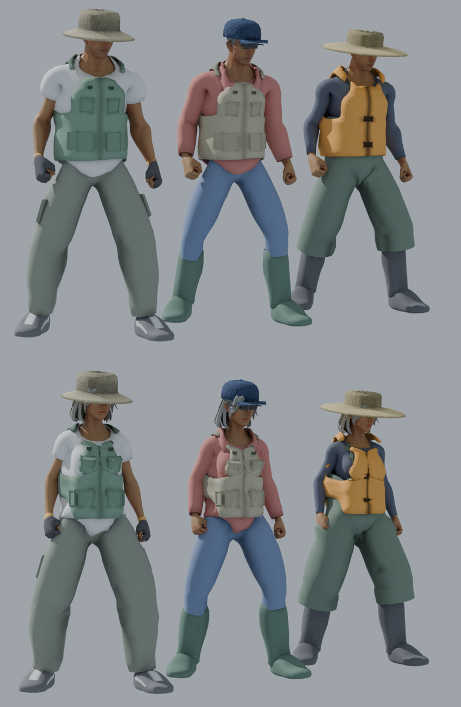

# 퀄리티 향상 계획 (캐릭터 + 무료 에셋)

데스크톱(Unity 6000.3.17f1이 설치된 PC)에서 이 문서를 위에서부터 따라 하면 된다.
클라우드 세션에서는 Unity를 실행할 수 없고 Asset Store·itch.io·Mixamo에도 접속할 수 없어서, **할 수 있는 데까지 만들어 두고 나머지를 여기에 적었다.**

- main에 머지됨 (작업 브랜치: `claude/character-quality`)
- 상태: 캐릭터 FBX·셰이더·코드까지 들어 있지만 **Unity에서 아직 한 번도 열어 보지 않았다.** 1단계 확인부터 할 것.

---

## 0. 왜 바꾸나

지금 캐릭터는 Quaternius 무료판에 들어 있는 **Superhero(보디빌더) 몸**에 셔츠·바지를 셰이더로 "칠한" 것이라 쫄쫄이 차림의 근육맨으로 보인다.
원작 「청풍명월」의 '청'·'명'은 보통 체형의 젊은 남녀가 **진짜 옷**(낚시조끼, 모자, 바지, 장화)을 입고 의상 아이템으로 꾸미는 3D 캐릭터였다.

| 게임 안 (docs/images/00_character.png) | Blender 미리보기 (`build_characters.py --preview`) |
|---|---|
|  |  |

미리보기(위→아래): 남자, 여자. 각 줄은 기본(반팔·낚시조끼·카고·운동화·벙거지·반장갑) / 프로(체크 남방(깃·단추)·조끼·청바지·장화·야구모자·선글라스) / 바다(래시가드·구명조끼·웨이더·장화·밀짚모자).
(처음엔 근육질 Superhero 몸에 옷을 셰이더로 칠한 쫄쫄이 차림이었다 — 지금은 위처럼 보통 체형 + 진짜 옷 메쉬.)

---

## 1. 이 브랜치에 들어 있는 것

### 1-1. 캐릭터 생성 파이프라인 `tools/blender/`
headless Blender(PyPI `bpy`)로 원본 Superhero FBX를 가공해 **Angler_Male.fbx / Angler_Female.fbx**를 만든다.

| 파일 | 하는 일 |
|---|---|
| `build_characters.py` | 진입점. 체형 다듬기 → 옷 생성 → 가림 마스크 → FBX 내보내기. `--preview`면 Cycles로 렌더 |
| `garments.py` | 옷 메쉬 생성: 몸 메쉬 복사 → 부위 선택 → 법선 오프셋 → 원통 좌표로 늘어뜨리기(드레이프) → 몸/아래 옷 밖으로 밀기 → 단 정리 → 두께. 모자·선글라스는 회전체로 직접 모델링 |
| `meshops.py` | 버텍스/가중치/BVH/스무딩 도우미 |
| `preview.py` | 렌더 장면(카메라·조명) |

- **체형**: 뼈 둘레 반지름을 줄여(팔 0.77, 가슴 좌우 0.84, 승모 0.7 …) 근육을 빼고, 몸통·팔다리만 Taubin 스무딩. 얼굴·손·발은 그대로.
- **옷 14종** (같은 아마추어, 몸 가중치 그대로 물려받음 → UAL 애니메이션에 그대로 따라 움직임)
  `Top_Tee` `Top_Long` `Top_Rash` · `Vest_Fishing`(주머니 6·덮개·D링·등판 망사) `Vest_Life`(버클) · `Pants_Cargo`(허벅지 주머니) `Pants_Jeans` `Pants_Wader`(멜빵) · `Shoes_Sneaker`(흰 밑창) `Shoes_Boots` · `Hat_Bucket` `Hat_Cap` `Hat_Straw` · `Glasses`
- **겹쳐 입기 순서**: 바지 → 상의(바지 허리 밖) → 웨이더(상의 밖) → 조끼(상의·웨이더 밖). 겹치는 옷끼리 z-fighting이 안 나게 밀어낸다.
- **옷 버텍스 컬러**: R 트림(목 리브·소매단·밑창·지퍼·주머니 덮개), G 음영, B 보조 원단(망사·밀짚), A 휴식 자세 높이/2(장화 신으면 바지 아랫단 잘라내기용)
- **몸 버텍스 컬러 = 가림 마스크**: R 상의(셋 다 덮는 곳), G 하의, B 신발, A 긴소매. 단 근처 2줄은 빼서 틈이 안 보인다.
- **FBX 헤더를 원본과 똑같이**(Z 위, -Y 앞, UnitScaleFactor 100) 내보낸다. 뼈 위치는 원본과 2e-5 이내, 노드 회전도 같다(Blender로 다시 읽어 비교함). → Unity에서 원본과 같은 루트 회전·크기로 들어와야 한다.

### 1-2. Unity 쪽 변경
| 파일 | 변경 |
|---|---|
| `Assets/Resources/Characters/Angler_Male.fbx`, `Angler_Female.fbx` | 새 캐릭터 (몸 + 옷 14종). **.meta 없음** → Unity가 처음 열 때 만든다(커밋할 것) |
| `Assets/ThirdParty/Quaternius/Source/Superhero_*.fbx` | 원본은 파이프라인 입력이라 Resources 밖으로 옮김(빌드에서 빠짐). GUID 유지 |
| `Assets/Shaders/Skin.shader` (구 Clothed, GUID 유지) | 피부. `_Clip`(상의·하의·신발·긴소매) 채널의 가림 마스크 > 0.5면 `clip` |
| `Assets/Shaders/Garment.shader` (새 GUID `25ddc010…`) | 옷. 트림·음영·망사·무늬(0 무지, 1 체크, 2 데님, 3 줄무늬, 4 밀짚 엮음), `_ClipBelow` |
| `ProjectSettings/GraphicsSettings.asset`, `Editor/ProjectTools.cs` | 두 셰이더를 Always Included에 |
| `Scripts/Characters/CharacterFactory.cs` | Angler FBX를 불러 입은 옷만 남기고 나머지 Destroy, 옷마다 머티리얼(트림 색 규칙). 프리미티브 모자·런타임 옷 마스크 굽기는 삭제 |
| `Scripts/Data/CostumeDatabase.cs` | `CostumeDef.Model`(옷 메쉬), `Pattern` 추가. 체크 남방=긴팔+체크, 소라 무늬=반팔+줄무늬, 청바지=데님, 구명조끼=Vest_Life, 웨이더, 장화 … |
| `Scripts/Core/PlayerProfile.cs` | `BuildLook()`이 Model/Pattern을 `CharacterLook`에 넣음 |
| `Scripts/World/WorldBuilder.cs`, `HonghyeonMap.cs` | NPC마다 옷 모양을 다르게(김사장 긴팔, 한강도사 웨이더+장화, 감생이사냥꾼 래시가드+구명조끼 …) |
| `Editor/AssetImportRules.cs` | 캐릭터 isReadable 끔(런타임에 메쉬를 안 읽음), Source 폴더는 애니메이션·머티리얼 없이 |

---

## 2. 데스크톱에서 할 일 ① — 시제품 확인 (먼저!)

```bash
git pull origin main
```
Unity로 열면 Angler FBX 두 개가 임포트된다(휴머노이드, AssetImportRules가 자동 설정).

### 확인 목록
1. **콘솔 에러 0** (셰이더 컴파일, C# 컴파일)
2. `Angler_Male.fbx` 인스펙터 → Rig 탭: Animation Type **Humanoid**, Avatar **Configure**에 초록색(본 매핑 성공). 예전 Superhero FBX와 같은 이름의 뼈라 자동 매핑되어야 한다.
3. Play → 대기실·한강:
   - 캐릭터가 **서 있고 정면(+Z)을 보며 키 약 1.76m** (누워 있거나 뒤돌아 있거나 100배면 아래 문제 해결 참고)
   - 옷이 몸과 함께 움직이고 걸을 때 살이 옷을 뚫지 않는다
   - 반팔이면 팔뚝 피부가 보이고, 긴팔이면 안 보인다 (Skin `_Clip.w`)
   - 장화를 신으면 바지 아랫단이 장화 속으로 사라진다 (Garment `_ClipBelow`)
4. **의상(C)**: 부위별로 바꿔 입기 → 모양까지 바뀐다(반팔↔긴팔↔래시가드, 조끼↔구명조끼, 카고↔청바지↔웨이더, 운동화↔장화, 모자 3종, 선글라스). 체크 남방·청바지 무늬.
5. 초상화(왼쪽 위), 1인칭 파이팅(팔·손), 배 운전·뱃머리 자세, 대기실 수족관 화면, NPC들
6. `sh tools/build.sh` → `sh tools/autoshot.sh` → `Screenshots/`에서 캐릭터가 나오는 장면 확인, 괜찮으면 `docs/images/00_character.png`, `21c_costume.png` 등 교체

### 문제 해결
| 증상 | 원인/대처 |
|---|---|
| 캐릭터가 누워 있음·뒤돌아 있음 | FBX 축 변환 차이. 인스펙터 Model 탭 **Bake Axis Conversion**을 원본 Superhero FBX 설정과 같게. 그래도 다르면 `CharacterFactory.Create`의 `Quaternion.Euler(0,180,0)` 조정 |
| 100배 크거나 작음 | Model 탭 **Convert Units** 켜짐 확인. 원본과 같게 `UnitScaleFactor 100`으로 내보냈으므로 원래는 같아야 함 |
| 아바타 매핑 실패(빨강) | Rig → Configure에서 T-포즈 강제(Pose → Enforce T-Pose) 후 Apply. 뼈 이름은 원본과 같다 |
| 옷이 몸과 따로 놀거나 찢어짐 | 옷 SkinnedMeshRenderer의 Root Bone/Bones 확인. 같은 FBX 안이라 원래 문제없어야 함. 특정 옷만 그러면 그 옷 가중치 문제 → `garments.py` |
| 옷이 전부 안 보임 | Hierarchy에서 SMR 이름이 `Top_Tee` 등인지 확인(Unity가 이름을 바꾸면 `CharacterFactory.Garments`와 안 맞음) |
| 피부가 통째로 사라지거나 다 보임 | 몸 버텍스 컬러가 안 들어왔음. Mesh 프리뷰에서 Vertex Color 확인. 임시로 `Skin.shader`의 `clip` 줄을 지우면 예전처럼 다 그린다 |
| 분홍색 | `Fishing/Skin`·`Fishing/Garment`가 빌드에 안 들어감 → 메뉴 Fishing/Setup Project 한 번 |
| 발가락·팔꿈치가 옷 밖으로 | 오프셋 부족. `garments.py`의 해당 옷 `base`(m) 올리고 재생성 |

---

## 3. 캐릭터 다시 만들기 (Blender 설치 불필요)

```bash
python -m venv bpyenv            # Python 3.13 (bpy 5.2 휠은 3.13용)
bpyenv/Scripts/pip install bpy pillow numpy      # Windows. Linux/macOS는 bpyenv/bin/pip
bpyenv/Scripts/python -I tools/blender/build_characters.py              # FBX 2개 생성
bpyenv/Scripts/python -I tools/blender/build_characters.py --preview --only male --out Screenshots/pv   # 렌더로 확인
```
- 옵션 `--closeup`(미리보기와 함께): 발(운동화·장화)과 상체(남방 깃·장갑·조끼)를 가까이 렌더해 `<out>_male_feet.png`, `_chest.png`로
- 옵션: `--only male|female`, `--pose Idle_Loop`(UAL 클립 이름, 미리보기 자세)
- 함정: 스크립트를 `inspect.py`처럼 표준 모듈 이름으로 만들면 bpy가 두 번 임포트되며 죽는다. 스크립트 끝에서 `os._exit(0)`(bpy 종료 시 충돌 회피), 명령줄 인자는 `import bpy` 전에 `sys.argv`에서 빼 둔다(이미 그렇게 되어 있음).
- 옷 하나를 고치려면 `garments.py`의 `top/vest/pants/shoes/hat` 인자(오프셋 `base`, 드레이프 `up_window`·`strength`, 단 높이)를 바꾸고 `--preview`로 본 다음 내보낸다.

---

## 4. 캐릭터 남은 개선점 (우선순위 순)

1. ~~**자연스러운 대기 자세**~~ — 완료(2026-10-15): **Human Basic Motions FREE**(Kevin Iglesias)의 Idle01·Walk01·Run01·Sprint01(남·녀)을 `Resources/Animations/KevinIglesias`로 옮겨 대기·걷기·뛰기·질주에 쓴다. 성별에 맞는 클립을 고르고 이동 속도에 맞춰 재생 배속을 정한다(10 문서 7장).
2. ~~**음영(AO) 굽기**~~ — 완료: `garments.bake_ao`가 휴식 자세에서 법선 반구로 광선 14개를 쏴 옷 버텍스 컬러 G에 곱한다(세기 0.6, 거리 12cm). 주머니·버클처럼 각진 면은 제외. 더 진하게/연하게는 `strength`.
3. ~~**장갑**~~ — 완료: `garments.gloves` = 손 껍데기 3.5mm, 손가락 둘째 마디부터 없는 반장갑, 손목띠(아래팔 뼈 축으로 1.2~6cm)는 트림 = 주황. Unity `CharacterLook.Gloves`(내 캐릭터만 true). 1인칭(`FightRodView`)도 검정 주먹 + 낚싯대를 감은 손가락 4개·엄지(끝마디 살색) + 주황 손목띠, 팔은 입은 상의 색 소매(반팔이면 팔꿈치 위까지, 긴팔이면 손목까지) + 아래팔.
4. ~~**운동화 모양**~~ — 완료: 발 부분은 몸 메쉬를 부풀리지 않고 `shoe_loft`로 새로 만든다(발 축을 따라 초타원 단면 41개, 앞코 둥글고 뒤꿈치는 조금 각지게, 밑은 평평한 밑창). 발목·종아리만 기존 껍데기. 몸 메쉬를 부풀리던 방식은 발가락 사이 점이 접혀 구겨졌다(투영+스무딩 반복도 소용없었음). 운동화는 끈(B → 셰이더 보조 원단 = 흰 끈)·옆면 줄무늬(R)·1.3cm 밑창. 장화도 같은 골.
5. ~~**체크 남방 깃**~~ — 완료: `garments.shirt` → `Top_Shirt` = 긴팔 + 깃(목둘레 띠 2.4cm + 접힌 깃, 앞이 벌어지고 깃 끝이 뾰족) + 앞단추 4개. 깃은 `strip_object`(격자 띠, 줄마다 가장 가까운 몸 버텍스의 뼈 가중치) + `join`. 의상 체크 남방·한강 블루 셔츠와 낚시점 주인 NPC가 입는다.
6. ~~**여자 캐릭터 조끼**~~ — 완료: V넥 깊이 = (목 − 가슴 높이) × 0.92(구명조끼 0.55), 너비 = 가슴 반폭 비율, 옆은 덜 파는 V(`neck_hole(v=0.55)`). 여자 윗가슴이 덮인다.
7. **얼굴** — UBC 얼굴은 실사 쪽이다. 원작 느낌(한국 MMO풍)을 더 원하면 아래 5장 VRoid 경로.
8. **피부 텍스처** — Superhero 텍스처에 복근 음영이 그려져 있다(옷에 가려 대부분 안 보임). 2026-10-14 확인: 반팔 팔뚝 근육 그림은 게임 카메라 거리(00_character)에서 눈에 띄지 않아 그대로 둔다. 가까이 보는 화면이 생기면 텍스처의 팔 UV를 흐리게.
9. ~~**머리카락 + 모자**~~ — 확인 완료: 긴 머리(Hair_Long) + 밀짚모자·야구모자 미리보기에서 머리카락이 챙을 뚫지 않는다(마스크 불필요).

---

## 5. 무료 에셋·패키지로 할 수 있는 것 (데스크톱에서)

이 프로젝트는 **Built-in Render Pipeline**이다. 아래는 Built-in 호환을 확인한 것 위주.

| 우선 | 에셋 / 패키지 | 어디서 | 쓰는 곳 | 메모 |
|---|---|---|---|---|
| ★★★ | **Post Processing** (`com.unity.postprocessing`, Post Processing Stack v2) | Package Manager → Unity Registry | 블룸(노을·가로등·다리 조명), 컬러 그레이딩(ACES), AO, SMAA, 비네트 | 가장 적은 노력으로 화면 전체가 좋아진다. 카메라에 `PostProcessLayer`, 전역 `PostProcessVolume`을 코드로 붙이고 시간대별로 그레이딩 값 보간(`Core`의 시계·조명 코드 옆). Unity 6에서 패키지가 보이는지 먼저 확인 |
| ★★★ | **Human Basic Motions FREE** (Kevin Iglesias) | [Asset Store](https://assetstore.unity.com/packages/3d/animations/human-basic-motions-free-154271) | 대기·걷기·뛰기·돌기·말하기(남/녀 118개) | 4-1 참고 |
| ★★ | **Mixamo** (Adobe 계정, 무료) — **적용됨 (10 문서)** | mixamo.com | 낚시 관련 동작(던지기·당기기·앉아 있기), 필요하면 캐릭터 | FBX for Unity, Without Skin으로 받으면 휴머노이드 리타깃. **라이선스: 프로젝트에 넣어 쓰는 건 되지만 원본 파일 재배포는 안 됨** → 저장소가 공개라면 git에 넣지 말고 `.gitignore`된 폴더에 |
| ★★ | **AllSky Free** / **Fantasy Skybox FREE** | [AllSky Free](https://assetstore.unity.com/packages/p/allsky-free-10-sky-skybox-set-146014), [Fantasy Skybox FREE](https://assetstore.unity.com/packages/slug/18353) | 흐림·비 날씨 하늘 | 지금 하늘은 낮밤이 도는 절차적 셰이더(`Sky.shader`)라 통째로 바꾸진 말고, 흐린 날 구름 큐브맵만 섞거나 반사 프로브용으로 |
| ★★ | **Stylized Hand Painted Nature Pack Free** / **Nature Starter Kit 2** | [Hand Painted](https://assetstore.unity.com/packages/3d/vegetation/trees/stylized-hand-painted-nature-pack-free-177775), [NSK2](https://marketplace.unity.com/packages/3d/environments/nature-starter-kit-2-52977) | 한강 둔치·홍현 갯바위 주변 나무·풀·덤불 | 지금 Kenney 나무는 너무 단순. NSK2는 2016년 에셋이라 Unity 6 임포트 후 셰이더 확인 |
| ★ | **Poly Haven** (CC0) | polyhaven.com | 나무 데크·콘크리트 둔치·자갈·바위 텍스처, HDRI | 이 컨테이너에서는 막혀 있었다. CC0라 저장소에 넣어도 된다 |
| ★ | **Quaternius / Kenney / KayKit** (CC0) | quaternius.com, kenney.nl, itch.io | 소품(아이스박스·의자·텐트·부표), 물고기 | Quaternius "Ultimate Modular Men/Women"은 캐주얼 옷이 있지만 로우폴리 인형풍이라 지금 캐릭터보단 원작과 멀다 |
| 선택 | **VRoid Studio + UniVRM** (pixiv, 무료) | vroid.com, github.com/vrm-c/UniVRM | 원작 '청'·'명' 같은 한국 MMO/애니풍 얼굴·머리 | 큰 방향 전환. VRoid에서 만든 모델은 휴머노이드라 UAL·Mixamo 애니메이션이 붙는다. 옷도 VRoid 안에서 만들 수 있음. 해 보고 지금 방식과 비교해 고르기 |
| 필요 없음 | Starter Assets – ThirdPerson | | | 이미 자체 컨트롤러가 있다 |

> 에셋 스토어 무료 에셋은 Standard Unity Asset Store EULA라서 **게임에 넣어 배포는 되지만 원본 에셋을 그대로 공개 저장소에 올리면 안 된다.** 공개 저장소라면 `Assets/AssetStore/`처럼 폴더를 정해 `.gitignore`하고, README에 "이 에셋을 받아서 넣으세요" 목록을 남긴다. CC0(Quaternius·Kenney·Poly Haven)는 지금처럼 커밋해도 된다.

### 에셋 말고 코드로 할 수 있는 화면 개선
- 밤 강물에 **다리 불빛 반사** 기둥(로드맵에 있음): 물 셰이더에 가로등·다리 조명 위치 배열을 넘겨 세로로 늘어진 하이라이트
- **반사 프로브** 하나(맵 중앙, 시간대가 바뀔 때 갱신) → 옷·보트·물의 반사가 하늘색을 따라감
- **그림자**: Directional Light 그림자 거리·캐스케이드를 캐릭터 주변에 맞추기(지금은 캐릭터 그림자가 흐릴 수 있음)
- **안개**: 시간대별 색(새벽 물안개는 이미 있음)을 하늘 지평선 색과 맞추기

---

## 6. 데스크톱 작업 순서 (체크리스트)

- [x] 2장 확인 목록 통과 → Angler FBX의 `.meta` 포함해 커밋 (2026-10-14: 빌드·autoshot에서 서 있음·정면·옷 확인)
- [x] 문제 있으면 2장 표대로 고치거나 `garments.py` 수정 후 3장으로 재생성 (`--preview --closeup`: 발·상체 근접 렌더)
- [x] Post Processing 패키지 + 코드로 볼륨/레이어 (블룸, Neutral 톤매핑, AO, SMAA, 시간대별 그레이딩) → `Core/PostFx.cs`. ACES는 노을·밤 하늘을 검게 눌러서 Neutral로 바꿨다
- [x] Mixamo 낚시 동작: Fishing Idle(낚싯대 들고 대기)·Fishing Cast(들기·던지기·챔질·릴 감기로 쪼갬)·Cheering(환호) → `Resources/Animations/Mixamo`, `CharacterAnimator`가 두 번째 라이브러리로 찾는다 (2026-10-14, [10 문서](10-animation.md))
- [x] Human Basic Motions FREE → Idle/Walk/Run/Sprint 교체 (2026-10-15, 10 문서 7장)
- [x] 4장 3(장갑)·4(운동화)·5(남방 깃)·6(여자 조끼) → 재생성, 9(머리카락+모자) 확인 (AO는 완료)
- [x] 데크·둔치·길·방파제 텍스처 (Poly Haven CC0: 풀·나무 데크·콘크리트·아스팔트, `Mats.TexturedBox`). 나무 교체(Hand Painted Nature Pack)는 에셋 스토어 로그인이 필요해 보류
- [x] 흐림/비 하늘, 반사 프로브: 큐브맵(AllSky)은 에셋 스토어 로그인이 필요해서 대신 `Sky.shader` 구름에 층구름(흐림·비에서 하늘을 덮는 회색 층)을 절차적으로 섞었다(`15b_cloudy_day`). 반사 프로브는 `DayNightCycle`의 하늘 실시간 프로브(시간대마다 갱신)
- [ ] (선택) VRoid 시험 모델 하나 만들어 비교 — 보류: VRoid Studio(데스크톱 앱) 수작업 필요
- [x] `sh tools/build.sh && sh tools/autoshot.sh`로 스크린샷 갱신, README 표·`docs/03-architecture.md`(Clothed → Skin/Garment, CharacterFactory 설명), `docs/05-dev-guide.md`(3장 명령), `docs/06-roadmap.md` 갱신 (2026-10-14)

Claude Code에 그대로 시킬 때 예시:
> `docs/08-quality-plan.md` 2장 확인 목록을 Unity에서 돌려 보고, 실패한 항목은 문제 해결 표대로 고쳐 줘. 통과하면 .meta 포함해서 커밋.
